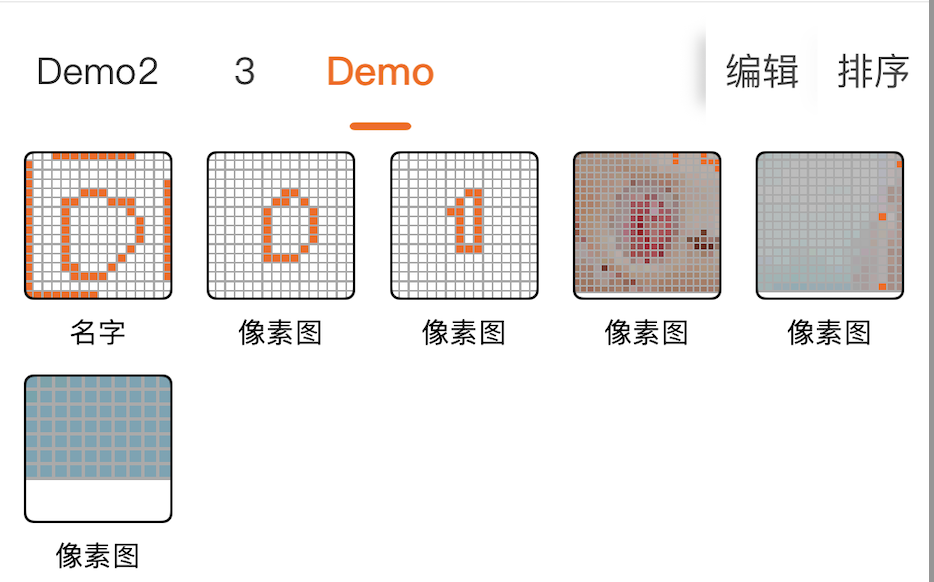
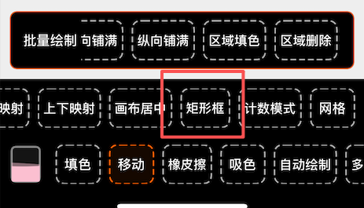
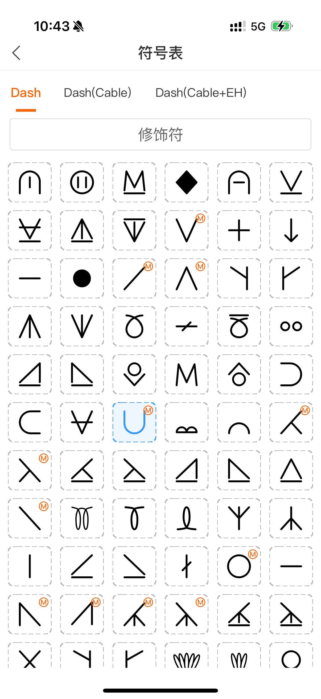
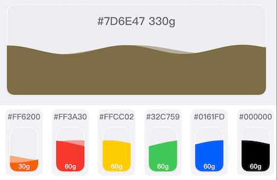

<!-- watch-settings-scenes-2026-11-12 -->
- 2026-11-12 · 开发中，未发布 · 协作设置按编织计数器、棒针编辑器、编织笔记和钩针编辑器分别配置。编织计数器、棒针编辑器、钩针编辑器和编织笔记已接入，可分别设置双指互点动作。 在编织笔记中，打开计数器的「…」菜单或长按计数器，选择「与 Apple Watch 协作」。绑定项显示手表标记，也可从右上角手表菜单切换目标。手表只操作已选计数器。手机翻页、收起面板或切到其他 App 后，连接保持时可以继续计数。离开阅读器会暂停，回到同一笔记后恢复。 手表可以连续加减。可推算的数字会立即显示，待同步次数在下方提示。iPhone 按顺序保存后确认。需要在手机确认的进位会暂停待处理操作，确认后继续。切换目标或计数设置时，请核对此前未确认的操作。棒针图解进入计数模式并开启行标后，右上角“更多”左侧出现手表按钮，手动开始或切换到当前图解，每次移动一行。首次绑定会先保存图解；手表显示图解名称、行号和总行数，到达边界时停止。退出计数模式、关闭行标或离开编辑器会暂停，已绑定时保留手表入口；重新打开同一图解并进入计数模式可恢复。仅切换到其他 App 看视频不解除绑定，保持连接时可继续计数。完整保存期间短暂暂停并自动恢复；修改行数或行号起点后需重新绑定。 钩针图解中，在某个计数器的“…”菜单选择“与 Apple Watch 协作”，只绑定该计数器；右上角手表菜单也可选择目标，并以勾选显示当前项。被绑定的计数器显示小手表标记，紧凑模式同样保留。点击其他计数器、改名、排序、翻页面板或收起面板都不会改绑；切到视频 App 后保持连接即可继续。加一沿用超过上限归零规则，减一不低于零；清零保持绑定，删除目标结束协作且不自动转给其他计数器。离开编辑器或编辑计数器弹层期间暂停，返回同一图解后恢复。开始前先保存，完整保存期间短暂暂停，钩针手势偏好独立配置。 “手表反馈”中的“计数震动反馈”默认开启，可自行关闭。该设置独立于作品，控制手表触屏加减和手势计数成功后的震动，并在手表连接后同步。
<!-- /watch-settings-scenes-2026-11-12 -->

<!-- workspace-recommendation-title-2026-11-11 -->
- 2026-11-11（开发中，未发布）：首页顶部推荐卡片的标题下方增加黑色渐变，浅色封面上的白色文字更清晰。
<!-- /workspace-recommendation-title-2026-11-11 -->

<!-- pattern-draft-3d-maintenance-2026-11-11 -->
- 2026-11-11（开发中，未发布） · 正式版点击「预览 → 3D试样」时会显示「3D预览维护升级中，敬请期待」。
<!-- /pattern-draft-3d-maintenance-2026-11-11 -->

<!-- bernat-debug-2026-11-10 -->
2026-11-10 · Debug · 开发版内部样板：重新构建 Debug App 后，在「新建版型→棒针→策略生成」列表底部打开「Bernat M · 四主片工程对照」。固定 M 码可编辑、保存和重开；不是自动放码策略，领边及罗纹仍待完善，已接入合成参考人体的实验试穿；最终质量和结果保存仍在验收中。

2026-11-11 · Debug · Bernat M 样板计算结束后，点「试穿反馈」，切换胸围、领口、袖口或下摆。虚线标出人体，实线标出衣物。胸围可设置目标松量，袖口同时列出左右落点，下摆同时列出前后落点。模板腕点、未完成领边和未通过质量检查的模拟结果会标明参考范围。 查看下摆时，短虚线标出人体参考腰线。点「查看人体」可临时淡化衣物，点「恢复衣物」可回到正常显示。拖动停手后，指示线会按最终视角重新定位。
<!-- /bernat-debug-2026-11-10 -->

<!-- discover-detail-2026-11-09 -->
- 2026-11-09（开发中，未发布）：修复从首页推荐或发现进入棒针详情时，主线程反复读取完整图库导致的卡顿。副本状态改为后台检查；发现、收藏和点赞列表的卡片文字与空白区均可进入详情，封面预览和收藏操作保持独立。
- 发现四频道的筛选默认收起，搜索框右侧可展开／收起，保留筛选数量、清除入口和列表位置；钩针报价的完整图库副本检查也改为后台执行，旧付费副本仍可直接打开。
- 搜索旁的展开／收起按钮按内容收紧并缩小箭头，为搜索框保留更多宽度。
<!-- /discover-detail-2026-11-09 -->

<!-- discover-recommendations-2026-11-08 -->
- 2026-11-08（开发中，未发布）：首页与发现推荐增加棒针、钩针、版型内置内容，按天稳定轮换。首页「快速开始」可直达发现对应频道；发现页记住 Tab 与各频道筛选，先显示本地内容，后台刷新时保留页面。内置推荐点击进入详情后再添加、打开或使用。
- 修复发现列表底部被裁切的问题，末条内容可完整滚入安全区域；切换频道及窗口尺寸变化时同步列表高度。
<!-- /discover-recommendations-2026-11-08 -->

<!-- crochet-instructions-2026-11-08 -->
- 2026-11-08（开发中）钩针编辑器加入「编织说明」。可阅读和编辑步骤、定位图解，或点符号查看对应步骤。新添加的往返短针试样、八环小星和三层花附带说明。
- 发现页全部 19 款内置钩针图解附带分步说明。打开钩针编辑器中的书本图标，可按步骤定位符号。已保存且与内置原图一致的副本打开书本即可加载。
<!-- /crochet-instructions-2026-11-08 -->

<!-- discover-earth-2026-11-08 -->
- 2026-11-08（开发中）发现新增 6 元档「双色立体地球」，提供逐圈针数、蓝绿换色和六并一闭合的完整可编辑图解。
<!-- /discover-earth-2026-11-08 -->

<!-- discover-snowman-2026-11-08 -->
- 2026-11-08（开发中）发现新增 6 元档「立体三段雪人」，包含逐圈编号、加减针、两次五并一收口和双色眼鼻，可添加为独立图解。
<!-- /discover-snowman-2026-11-08 -->

<!-- discover-stocking-2026-11-08 -->
- 2026-11-08（开发中）发现新增 6 元档「爆米花针长袜」。完整图解有工序编号、来源和可编辑副本，尺寸由线材、针号和密度试样确定。
- 修正发现钩针频道同日发布的排序。选择「最新发布」时，较晚加入的批次排在上面。
<!-- /discover-stocking-2026-11-08 -->

<!-- discover-paid-crochet-2026-11-08 -->
- 2026-11-08（开发中）：发现新增「花心祖母方片」和「立体婴儿鞋」两款完整复杂钩针图解，各为6元档。提供工序编号、来源和可编辑副本。婴儿鞋尺寸按线材、针号与密度试样确定。
<!-- /discover-paid-crochet-2026-11-08 -->

<!-- discover-crochet-charts-2026-11-08 -->
<!-- discover-apple-luna-high-2026-11-08 -->
- 2026-11-08（开发中）：发现 → 钩针新增「立体苹果」完整图解，983 枚有效针法，按复杂度进入 6 元档。图解含逐圈分段、共底加针提示、来源和可编辑副本；已通过独立复核与简中模拟器验收。
- 补充：当前通过的是针序、图解版面和 App 回读验收；整件形状与来源 3D 模型的并排对照待补，不能据此确认成品外形。
<!-- /discover-apple-luna-high-2026-11-08 -->
- 2026-11-08（开发中）：「发现 → 钩针」新增三层花、双面五瓣花和狗牙边叶片。三款各为 1 元档，可查看来源和读图说明，解锁后可添加到钩针编辑器。已保存的副本可直接打开。 内置图解首次打开会显示全图，重开时恢复已保存的视口。
<!-- /discover-crochet-charts-2026-11-08 -->

<!-- discover-chart-commerce-2026-11-07 -->
- 2026-11-07（开发中，未对外发布）：发现增加全部／免费／付费筛选、可查看来源的原生参考图解及逐款解锁；消耗型解锁记录随整库备份保存，未完成交易可重试处理且不会再次发起付款。
- 新添加的副本按圈织补入下针。针法为 Line 补充，可编辑。
- 这批参考图解的发现封面、大图预览和新副本缩略图都显示圈织下针。
- 进入「发现 → 钩针」，可浏览首批 10 款内置图解，包括试样、纹理、边饰和花片。打开详情可查看参考来源、预览针法符号。添加后，可在钩针编辑器中编辑本地副本。付费款沿用棒针图解的消耗型内购档位，按款解锁。列表可按「全部／免费／付费」筛选。
- 首批10款棒针和10款钩针图解现全部免费。今后按一个完整花片或最小重复单元中的有效符号评估：不超过100个，或属于基础重复、简单配色，均免费；101–300个且有中等复杂度，为¥1候选；301个以上且复杂度高、交付完整，为¥6候选。数量不会自动触发收费，实际付费价格以商店为准。
<!-- /discover-chart-commerce-2026-11-07 -->

<!-- chart-json-readback-2026-11-06 -->
- 2026-11-06（开发中，未发布）：修复棒针图解 JSON 回读时粗网格线颜色的恢复；已通过针对性原生模拟器测试，真机待验。

<!-- discover-filter-selection-2026-11-06 -->
- 发现分类和主题标签改用浅橙底、橙色文字与细描边表示选中，统一明暗主题样式。

<!-- discover-content-search-2026-11-06 -->
- 2026-11-06（开发中，未发布）：发现频道新增搜索、分类/主题筛选及推荐/时间排序，缓存或部分结果可重试。静态和编译检查通过，真机待验。

- 2026-11-06（开发中，未发布）：修正棒针与钩针编辑器顶部菜单的安全区布局，避免被刘海或灵动岛遮挡。待真机验证。

- 版型3D：改善人体肩臂与髋腿过渡，支持合格预览随作品保存和恢复，修复继续模拟的阶段提示。完整成衣试穿仍在改进中。

- 2026-10-27（开发中，未发布）：版型新增测量驱动的人台模板及真实3D参考材料试样，支持闭合衣片摆放、临时固定、重力垂落和基础背心接缝；修改2D轮廓后可更新、同条件对比及导出效果图。人体原型与2D对照保留，旧伪3D入口转为真实3D。已做模拟器验证，仍待真机验收；不提供精确合身或压力结论。 修复复制人体原型衣片的闭合/镜像边界兼容和直线采样误报自交；衣片无效时仍显示当前人体并说明原因，修正后可重试。

- 2026-10-26（开发中，未发布）：版型工作台补任务菜单、直线/圆/构造点、统一对象层次与锁定、前后身原型1:1对照、窗口恢复、图纸样式及记录/文件同源预览。旧作保留；未编译，待真机验收。 新增椭圆、衣片边柄拉伸/角柄等比、比例锁、精确尺寸与独立排版旋转；真实缩放更新估算，排版不改编织方向。 人体原型补只读组件选框、位置锁与解锁拖动，选择参考自动退出画笔，位置可撤销及保存。 连续绘制时收起自动对象菜单，切回选择或节点编辑后恢复。 选中对象菜单保留常用操作并可直达对象与图层；列表更多支持编辑、重命名、复制、层序和确认删除，锁定禁改，参考隐藏保源。删除衣片保留人工标注与图解记录并提示关联失效，可撤销。 原型前身、后身、袖部及各人体参考可单独移动、显隐和排序。双击快捷编辑并可完成返回原工具，草绘和图片支持整体变换。几何完成与明确结束轮廓后在固定工具区显示快捷菜单，保持绘制工具；画笔、橡皮和未完成路径不弹出。

- 2026-10-26（开发中，未发布）：普通短提示显示期间仍可点击按钮、滚动列表和操作画布；加载提示继续按原有范围阻断交互。编织笔记保留顶部提示位置，并修复连续提示被提前清除的问题。未编译，待真机验证。

- 2026-10-23（开发中，未发布）：版型全流程改为自由画布，可从空白、策略、模板或人体原型起稿；补充关联尺寸、Text/Tips、当前轮廓估算、按需预览和输出回流、设计图导出及旧作品保护。尚未编译、尚待真机验收；3D分离衣片展示不代表布料试穿。

- 2026-10-23: 已保存的钩针图解会在离开编辑器或切到后台时记住画布位置和缩放，重新打开时优先恢复；仅移动或缩放也会保存。旋转屏幕或改变窗口大小后，原来视口中心的画布位置会回到当前视口中心。未编辑的新建空白图仅浏览后关闭不会生成记录。

- 2026-10-23: 已保存的棒针图解会在离开编辑器或切到后台时记住画布位置和缩放，重新打开时优先恢复；仅移动或缩放也会保存。旋转屏幕或改变窗口大小后，会让原来视口中心对应的图解位置回到当前视口中心。未编辑的新建空白图仅浏览后关闭不会生成记录。

- 2026-10-22: 优化图解较多作品的详情加载：先展示基本信息，再更新资源摘要；作品技法改为点击后分析，具体图解按需加载。

### 建议及时更新版本，享受更佳的用户体验。

> 新功能建议，可以前往反馈页面底部，前往开发者小红书联系！

### v2.1.3 （近期版本）

- 新增自动数据备份能力
- iPhone Duo 设备适配

钩针版块（按用户反馈体验升级）
- 多个长型针法开放曲率拉伸变形能力；
- 提供多选区域便捷操作，相似针法图的各项复制镜像能力；
- 其他钩针的用户体验优化；
- 图解 3D 模拟能力开发中，敬请期待

棒针版块
- 图解 3D 渲染能力持续升级中，数百中针法逐渐接入 3D 渲染能力
- 超大型图解的渲染算法升级

版型版块
- 当棒针的 3D 渲染能力达到目标之后，版型会开始支持 3D 人体试穿效果

### v2.0.3
- 新增发现模块，精选图解等你来织
- 其他体验优化及问题修复

### v2.0.2
- 新增并优化版型设计相关功能，让编织版型的创建与编辑更加便捷。
- 优化棒针图解等功能的使用体验。
- 修复已知问题并提升应用稳定性。

### v2.0.1
更新日志
* 各版块增加文件索引系统（支持各维度筛选及排序）；
* 首页快速入口改版（一键直达核心目标页面）；
* 全新设计的毛线库存版块（更加丰富的内容记录及批量操作）；
* 棒针自定义符号支持使用图片，并可选择完整显示或填满裁切；
* 其他功能体验优化（炫酷的照片翻转查看效果）；

### v2.0.0(重磅更新)
* 作品版块对接 Ravelry网，免费图解快速获取
* 全新的棒针 & 钩针符号详情，教学视频让你少走弯路
* 棒针编辑器全新往返、圈织计数模式

### v1.9.9
根据用户反馈优化
* iPad支持横竖屏切换；
* 棒针编辑器体验升级，提供更多便利区域操作；
* 其他UI及用户交互体验优化；

### v1.9.8

根据用户反馈优化
* 修复图解绘制时的卡顿问题；
* 计数器多任务编织计划模块升级；
* 计数器内部图解模块升级；
* 其他交互体验优化；

### v1.9.7
钩针编辑器
- 编辑器支持自动保存策略；
- 新增50+新钩针符号；
- 其他UI细节及交互体验优化。

棒针编辑器
-  超千行围巾图解绘制支持；
- 为超长图解提供画布定位支持；
- 支持自动保存策略，避免绘制进度意外丢失；

### v1.9.5~1.9.6
- 棒针工具支持超长图解（千行）围巾等绘制，并提供快捷定位导航；
- 棒针工具提供自动绘制图解符号功能；
- 设置模块升级，开始支持多项数据备份能力；

### v1.9.2~1.9.4
- 新增内置新手教学作品，快速了解作品、计数器、图解与编织笔记。
- 支持完整作品包导入导出，包含毛线、图解、PDF 与图片资源。
- 升级棒针图片辅助绘制及 PDF 图解网格校准体验。
- 优化棒针、钩针、计数器和编织笔记，并新增五语言使用帮助。
- 修复多项导入、显示与稳定性问题。

### v1.8.9 ~ 1.9.1
* 全新工作台模式重磅上线
* 钩针版块体验升级

### v1.8.8 编织笔记版块开始支持
* 修复iPad上iOS26.3+ 的tabbar不消失bug

新增编织笔记模块
* 缩略图支持快捷导航功能
* 内含多个计数器
* 多个可以转向、可以缩放尺寸的标尺
* 元素管理版块

### v1.8.7

* 全新页面布局： 我们调整了整体视觉与结构，将高频使用的工具迁移至首页，常用功能一触即达；
* iOS 26 深度优化： 针对最新系统进行了全面的体验适配，紧急修复了 iPad 客户端在导出页面时跳转失效的已知问题；
* 细节体验升级： 优化了多项底层性能与交互细节，让日常使用更加丝滑顺畅。

### v1.8.6
* 全新多语言棒针符号库与针法详解
* 像素编辑器新增区域剪切、选框信息和统一导出
* 支持颜色与针法图例、作者及版权信息
* 编织计数器支持连续查看多页 PDF
* 优化自定义钩针符号、深色模式及操作稳定性

### v1.8.5
棒针工具
- 缩放和平移画布时，选中的格子会牢牢固定，再也不会跟着画面乱飘。
- 选区把手会自动吸附到单元格边缘，且大小固定、触控变红，操作更精准。
- 移除了选区闪烁定时器，大幅降低了开着选区挂机时的手机发烫和耗电问题。
- 长针法符号在复制铺满时，如果末端空间不足会自动保留原样，绝不会把符号切断。
- 连续铺满操作现在支持一键撤销，点一下就能恢复原状，不用再狂点几十次。
- 跨格的长符号现在点击任意一格都能全选，并且支持一键整体替换，同时保持原有颜色。

钩针工具
- 画布支持以双指中间为中心进行缩放，放大缩小更跟手，不再迷路。
- 移动符号时新增横竖十字辅助线，帮你轻松完美对齐每个元素。
- 编辑框和把手大小固定不变，按住把手时会变成红色，给你清晰的触控反馈。
- 新增自动模式，点击空白直接新建，点击元素直接编辑，省去频繁切换工具的麻烦。
- 支持长按或点击底部按钮多选，选中的符号可以一键打包成组。
- 成组后的符号支持整体移动、旋转、缩放和复制，双击还能单独修改组内单个成员。
- 圆形或矩形等排布新增正反方向、朝里、朝外、竖直等多种朝向调整，起点也能随心换。

其他
- 提示文案全面同步简体中文、英文、日语、韩语、法语，多国语言顺畅切换。
- 完美兼容历史作品，升级后旧图纸可以正常打开和编辑，数据安全无影响。

### v1.8.3 & 1.8.4
- 钩针符号样式渲染优化。
- 优化自动绘制效果，新增单色及多种绘制风格与实时预览。
- 重构画布元素管理，支持按填充色、针法分类查看。
- 新增批量选择、填充换色、符号换色及删除操作。
- 优化撤销、恢复及画布控制工具的操作体验。
- 改进图片工具提示、弹层布局与多语言支持。
- 修复图片切换、透明度显示及弹层滚动等问题。
- 优化多种尺寸像素画布的绘制表现与操作稳定性。

### v1.8.2
- 编织计数器升级，当稳定编织模式与变化模式切换时，行针数据会保留同步；

### v1.7.5
- 为支持部分用户的用眼健康，开始支持暗黑模式；

### v1.7.1 ~ 1.7.2
- 棒针图解开始支持快捷模版，可在画布中直接渲染
{: width="320"}

### v1.6.7 ~ 1.7.0
- 钩针制图工具上线
- 编辑器添加70+ 钩针符号

> 这是首版，后续会根据实际体验逐步迭代升级

### v1.6.2 ~ 1.6.5（如果你不喜欢开发者提供的数据项归纳格式？）

- 毛线版块、编织作品版块、图解版块统一开始支持文件自定义管理，用户可以按照自己喜欢的方式归纳数据项；
- 为支持部分用户高频操作画布的诉求，提供外置的统一样式设置及提示语屏蔽选项；
- 图解编辑器导出支持高清矢量图方式，支持设置导出文件的标题及描述；

### v1.6.1
日常更新（用户反馈优化）
- 棒针编辑器内开始支持画布尺寸调整；
- 计数器新增第三种类型文本图解，字体可调；

### v1.5.9 & v1.6.0

- 新增工具毛线编织小样模拟器，一键获取编织密度；
> 编织小样依赖于特定毛线，因此它的入口位于毛线详情页；

### v1.5.7 & v1.5.8
编织作品及毛线记录版块升级；
- 作品（棒针、钩针）作品在关联所用毛线时，会自动计算消耗克重以及相关的价格
- 优化毛线详情页上下滑动时，已输入数字被替换的问题；
- 毛线记录版块新增作品关联消耗，自动添加已耗重量及价格的估算；
- 即将移除毛线首页各种分类查看的限制；

### v1.5.6 计数器模块升级
- 计数操作日志新增备注功能，用于记录错误或回溯；
- 日志颜色加强[+][-]操作的区分度；

### 日常更新 v1.5.2 ~ 1.5.5，符号版块大改版

编制符号手册
- 按针法基本针法、加针、减针等版块划分所有符号
- 基本符号及修饰符支持中、英、日的三语对照详情

### 日常更新 v1.5.0 & 1.5.1
- 编辑器多选控制区新增杂色处理功能，支持杂色阀值处理以及颜色集合快捷归并等；
- 移除框选功能的限制权限，可完全使用相关功能；
- 编辑器支持跨作品区域复制，可以便捷的将不同作品打破重组；
- 添加一些共享作品，以及可共享的上传通道；

### 日常更新 v1.4.5 & 1.4.6

- 编辑器支持框选批量复制、粘贴、横纵铺满以及区域填色等操作，提花效率倍增；
{: width="300"}

- 增加了共享图解版块，持续添加可用的提花图解，下一步更新费尔岛提花；
- 自动绘制算法优化；

### v1.4.4

- 编辑器网格线行列支持自定义加粗间隔；

{: width="300"}

- 编辑器浮动坐标支持设置起始位置;

{: width="300"}

### v1.4.0~1.4.2重磅发布支持500+编织符号
重磅升级，新增500+编织符号组合
- 新增基础符号表(三大类Dash类型)；
- 新增自定义符号模块，符号自定义；
- 图解编辑器开始支持绘制符号库；

{: width="300"}

### 1.3.8

日常更新
- 颜色选择器支持从调色桶选色；
- 毛线及作品图片信息体验优化，支持新增及单图删除功能；
- 本版多语言开始支持韩语；

### 1.3.7 计数器升级 & 联动图解编辑模块

- UI体验升级，收拢各类控制按钮统一管理；
- 可以通过导入图解作品，来启动内部图解样式；
- 联动图解编辑模块，提供真实的图解计数；
- 提供类旧式打印机式的引导体验及各类样式配置；
- 可定制的行列计数模式，编织进度一目了然；
- 单独的坐标控制键盘，加减一触即可；
- 持久化的模式记忆，创作编织无缝切换；
- 快捷的输入功能，可空降任意行列坐标；
- 编辑器颜色选择支持记忆透明度；
- 优化多选模式操作体验；

### v1.3.6

重磅更新
- 工具区升级为分栏模式，按模块分类；
- 新增十字绣、提花及花色毛衣图解制作工具，提供可选的悬浮坐标系统；
- 图解项支持源文件级的分享，可无缝导入任意用户的图解源文件；
- 编辑器开始支持灵活的多选功能，各类批量处理用以提升创作效率；
- [多选模式]及[网格]模式加入工具区；
- 其他各类操作体验优化；

### v1.3.5

日常更新
- 像素创作放开尺寸预设，现可自定义行列数了；
- 图片编辑器优化，增加原图尺寸比例；
- 修复iPad上pdf文件格式导出异常的bug；
- iPad上作品编辑器页面修改为全屏展示；

### v1.3.3 ~ 1.3.4

> 1.3.4版本对画布的自动绘制算法及网格相关的使用体验进行了优化，当网格线隐藏时，自动绘制的结果可以比较好的还原底图了。

- 像素作品列表重构，支持预览图与更新日期，加载效率足以支持多部复杂作品同时进行；
- 画布放开了放缩的比例限制；
- 导出高清PDF文件功能优化，无论作品多复杂，均能放大至较大尺寸观看；
- 画布相关色值支持带有透明度（RRGGBBAA）的16进制色值；
- 其他一系列工具操作体验优化；

### v1.3.1（全新的像素化创作工具）~ v1.3.2

这是一个有趣的拼豆像素化创作工具；
- 支持各个维度的色彩定制，从单元格至画布背景，色彩随心意；
- 支持水平及垂直方向的同步绘制，映射总能创作令人意外的作品；
- 支持画布随意移位及放缩，并且导出时总以画布最终位置为准；
- 支持底图临摹，图片支持裁剪以及其他必要的操作；

### v1.2.6~1.3.0(新增工具调色桶)

- 调色桶支持混合不同比例的颜料及重量，万色可调；
- 用心调制出来的色桶支持本地存储；

{: width="300"}

### v1.2.5

- 毛线管理模块新增余量监测模块，当毛线低于设定的阀值时，会在余量告急表内展示，用户可以选择补充库存或其他操作；

### v1.2.3~v1.2.4
- 体验优化
- 新支持额外的语言种类

### v1.2.2
新版功能

- 作品模块支持日历查看；
- 作品发布器新增日期及花费，可用于日历展示；
- 日历模块内新增近期日期范围快捷键；

### v1.2.1
新功能扩展

- 毛线库存增加日历筛选模块，支持任意时间段
- 重构发布器日期选择模块，新增日期选择器；
- 计数器为联动功能提供控制阀，可按需关闭；

### v1.2.0
计数器升级，图解区与计数区开始联动

- 当计数行变化时，图解自动滚动至选中行；
- 图解区左侧支持行标记，选中会联动图解；
- 图解与行标记滚动联动；
- 增加联动设置页，用于联动关系的设置；

### v1.1.9
功能扩展

- 新增工具区，便于后续各种辅助工具的添加；
- 本次新增智能颜色采集器，能够采集目标区色值；
- 毛线发布器也扩展了颜色采集器；

### v1.1.8
计数器模块体验优化

- 照片图解采用矢量渲染方式以提高缩放清晰度；
- 当选项卡完整呈现时，计数区与控制区触发更新；
- 优化图解在tab切换时，展示区域被重新渲染的体验；

### v1.1.7
- 新增永久会员选项；
- 分析模块体验优化；
- 同步功能体验优化;

### v1.1.6

毛线模块优化
- 新增颜色选择器，辅助用户选色；
- 最低系统版本降级至iOS14+；
- 库存分析内容扩展；
- 其他一些体验优化；

> 其他版本更新内容可在AppStore-App主页查看。

<!-- bernat-debug-tryon-2026-11-10 -->
进入 3D 后，样板使用合成参考人体。试穿计算结束后，可以通过分享按钮保存工程预览图。质量检查通过后才会保存为可重开的试穿结果。
<!-- /bernat-debug-tryon-2026-11-10 -->
