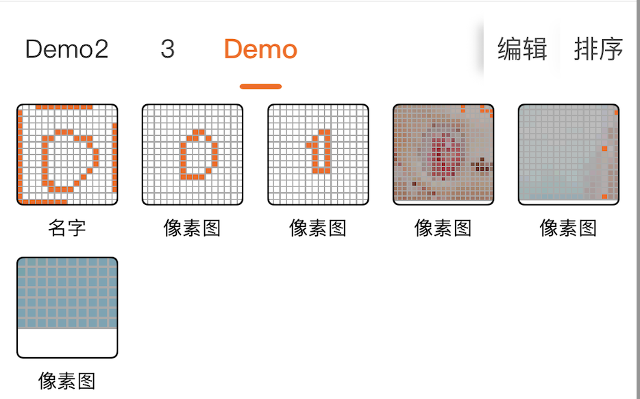
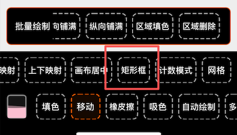
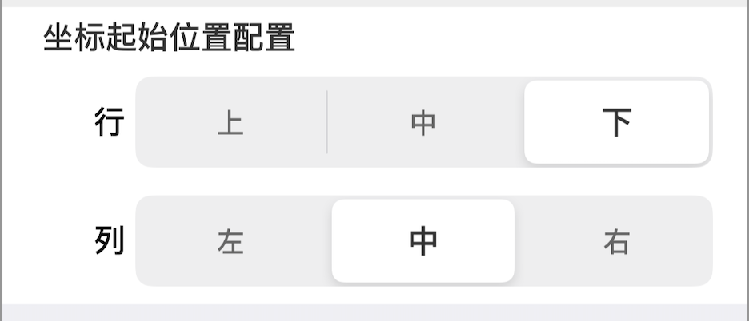
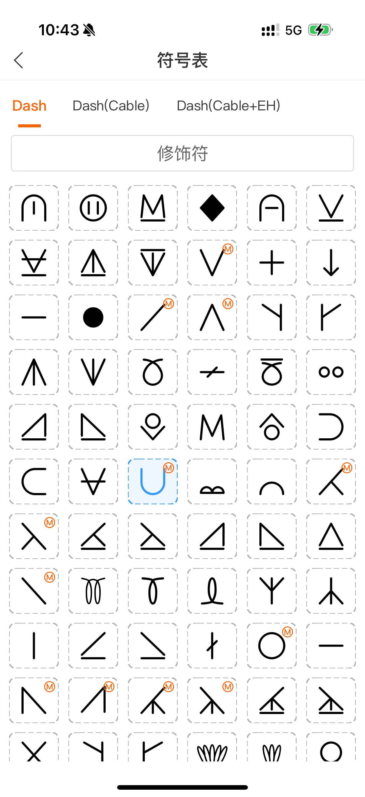
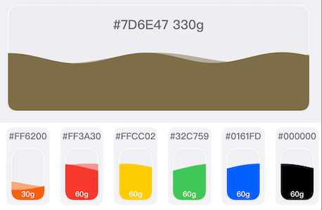

---

layout: default
title: "Versionsverlauf"
lang: de
---

<!-- watch-settings-scenes-2026-11-12 -->
- 2026-11-12 · In Entwicklung, unveröffentlicht · Die Einstellungen sind für Zähler, Strickschriften, Notizen und Häkelschriften getrennt. Zähler, Strickschriften, Häkelschriften und Stricknotizen unterstützen eigene Doppeltipp-Aktionen. Öffne in einer Stricknotiz das Zählermenü oder halte den Zähler gedrückt und wähle Mit Apple Watch verbinden. Ein Watch-Symbol markiert den verbundenen Zähler. Im Watch-Menü oben rechts kannst du das Ziel wechseln. Die Watch steuert nur den ausgewählten Zähler. Beim Umblättern, Ausblenden des Felds oder Wechsel zu einer anderen App kannst du bei bestehender Verbindung weiterzählen. Das Verlassen des Lesers pausiert die Zusammenarbeit. Kehre zur selben Notiz zurück, um fortzufahren. Auf der Apple Watch kannst du mehrmals hintereinander erhöhen oder verringern. Berechenbare Werte erscheinen sofort, offene Aktionen darunter. Das iPhone speichert und bestätigt die Aktionen der Reihe nach. Ist eine Bestätigung auf dem iPhone nötig, pausieren die Aktionen bis dahin. Prüfe unbestätigte Aktionen, wenn du Ziel oder Zähleinstellungen änderst. Aktiviere in der Strickschrift Zählmodus und Reihenmarkierung: Oben rechts erscheint links neben Mehr eine Watch-Taste. Starte oder wechsle das Ziel manuell, um jeweils eine Reihe zu verschieben. Vor dem Verbinden wird gespeichert. Die Watch zeigt Name, Reihennummer und Gesamtzahl und stoppt an den Grenzen. Beim Verlassen des Zählmodus, Ausschalten der Reihenmarkierung oder Verlassen des Editors wird pausiert; das verbundene Ziel behält die Watch-Taste. Öffne dieselbe Strickschrift im Zählmodus, um fortzusetzen. Beim Wechsel zu einer Video-App kannst du bei bestehender Verbindung weiterzählen. Vollständiges Speichern pausiert kurz und setzt automatisch fort. Nach Änderungen an Reihenzahl oder Reihenursprung muss neu verbunden werden. Wähle in der Häkelschrift im Menü eines Zählers Mit Apple Watch verbinden, um nur diesen zu steuern. Auch das Watch-Menü oben rechts bietet Ziele an und markiert das aktuelle. Am verbundenen Zähler bleibt selbst in der kompakten Ansicht ein Watch-Symbol sichtbar. Andere Zähler antippen, umbenennen, umsortieren, Seiten wechseln oder das Feld ausblenden ändert das Ziel nicht. In einer Video-App kannst du bei bestehender Verbindung weiterzählen. Nach Überschreiten eines positiven Maximums geht es auf null zurück; Verringern endet bei null. Zurücksetzen behält die Verbindung. Löschen des Ziels beendet sie ohne Ersatzwahl. Verlassen des Editors oder Bearbeiten des Zählers pausiert; Rückkehr zur gleichen Häkelschrift setzt fort. Vor dem Verbinden wird gespeichert, vollständiges Speichern pausiert kurz und Häkelgesten haben eine eigene Einstellung. Das haptische Zählerfeedback unter Watch-Rückmeldung ist standardmäßig aktiviert und kann ausgeschaltet werden. Die projektunabhängige Einstellung steuert Vibrationen nach erfolgreichem Zählen per Taste oder Geste und wird bei verbundener Watch synchronisiert.
<!-- /watch-settings-scenes-2026-11-12 -->

<!-- workspace-recommendation-title-2026-11-11 -->
- 2026-11-11 (in Entwicklung, unveröffentlicht) – Ein dunkler Verlauf hinter den Titeln der Empfehlungskarten auf der Startseite verbessert die Lesbarkeit weißer Schrift auf hellen Titelbildern.
<!-- /workspace-recommendation-title-2026-11-11 -->

<!-- pattern-draft-3d-maintenance-2026-11-11 -->
- 2026-11-11 (in Entwicklung, unveröffentlicht) · In der veröffentlichten Version zeigt die Schaltfläche für das 3D-Muster im Schnitteditor einen Wartungshinweis an.
<!-- /pattern-draft-3d-maintenance-2026-11-11 -->

<!-- bernat-debug-2026-11-10 -->
2026-11-10 · Debug · Internes Debug-Beispiel: App neu bauen und Bernat M unten unter Neues Schnittmuster → Stricken → Strategieerstellung öffnen. Die vierteilige Referenz in fester Größe M lässt sich bearbeiten, speichern und erneut öffnen. Automatische Größenanpassung, Halsbündchen und Rippen sind noch nicht fertig. Die experimentelle Anprobe nutzt jetzt einen synthetischen Körper; endgültige Qualität und Ergebnisspeicherung werden geprüft.

2026-11-11 · Debug · Nach Abschluss der Berechnung für Bernat M kannst du unter **Passform** Brust, Halsausschnitt, Bündchen oder Saum wählen. Gestrichelte Linien zeigen auf den Körper, durchgezogene auf das Kleidungsstück. Lege einen Zielbereich für die Brustzugabe fest und vergleiche beide Bündchen oder den vorderen und hinteren Saum. Das Fenster kennzeichnet Vorlagenpunkte, ausstehende Maße am Halsbündchen und Ergebnisse ohne bestandene Qualitätsprüfung. Im Bereich Saum markiert eine kurze gestrichelte Linie die Referenztaillenlinie. Tippe auf **Körper ansehen**, um das Kleidungsstück durchscheinend anzuzeigen, und auf **Kleidung wiederherstellen**, um zur normalen Ansicht zurückzukehren. Nach dem Verschieben richten sich die Hilfslinien wieder an der Ansicht aus.
<!-- /bernat-debug-2026-11-10 -->

<!-- discover-detail-2026-11-09 -->
- 2026-11-09 (in Entwicklung, unveröffentlicht): Wiederholte vollständige Bibliotheksabfragen blockieren beim Öffnen von Strickdiagramm-Details aus Home oder Discover nicht mehr den Hauptthread. Gespeicherte Kopien werden im Hintergrund geprüft. Text und freie Flächen der Karten in Discover, Favoriten und Likes öffnen die Details; Bildvorschau und Favoriten bleiben getrennte Aktionen.
- Die Filter aller vier Discover-Kanäle starten zugeklappt und lassen sich neben der Suche auf- und zuklappen. Aktive Anzahl, Filterlöschung und Listenposition bleiben erhalten. Auch Preisangebote für Häkeldiagramme prüfen gespeicherte Kopien im Hintergrund; vorhandene kostenpflichtige Kopien bleiben nutzbar.
- Die Schaltfläche zum Auf- und Zuklappen passt sich nun ihrem Inhalt an; ein kleinerer Pfeil lässt mehr Platz für die Suche.
<!-- /discover-detail-2026-11-09 -->

<!-- discover-recommendations-2026-11-08 -->
- 2026-11-08 (in Entwicklung, noch nicht veröffentlicht): Startseite und Entdecken zeigen integrierte Strick- und Häkeldiagramme sowie Schnittstrategien in einer täglich wechselnden Auswahl. Der Schnellstart öffnet den passenden Entdecken-Kanal. Tab und Filter je Kanal bleiben gespeichert; lokale Inhalte erscheinen zuerst und bleiben beim Aktualisieren sichtbar. Empfehlungen öffnen zunächst die Details zum Hinzufügen, Öffnen oder Verwenden.
- Abgeschnittene Inhalte am Ende der Entdecken-Listen wurden korrigiert. Die letzte Karte lässt sich vollständig anzeigen; die Listenhöhe folgt Kanal- und Fenstergrößenänderungen.
<!-- /discover-recommendations-2026-11-08 -->

<!-- crochet-instructions-2026-11-08 -->
- 2026-11-08 (in Entwicklung). Im Häkel-Editor kannst du Anleitungen lesen und bearbeiten, die Symbole eines Schritts anzeigen und durch Antippen eines Symbols den zugehörigen Schritt finden. Neu hinzugefügte Kopien der Maschenprobe, des Sterns mit acht Bögen und der dreilagigen Blüte enthalten Anleitungen.
- Alle 19 integrierten Häkeldiagramme in Entdecken enthalten jetzt Schritt-für-Schritt-Anleitungen. Öffne im Editor das Buch, um die Symbole für jeden Schritt zu finden. Gespeicherte Kopien, die dem Original entsprechen, laden die Anleitung beim Öffnen.
<!-- /crochet-instructions-2026-11-08 -->

<!-- discover-earth-2026-11-08 -->
- 2026-11-08 (in Entwicklung). Unter Entdecken gibt es die zweifarbige 3D-Erde für 6 Yuan. Die bearbeitbare Häkelschrift enthält Rundenzahlen, blau-grüne Farbwechsel und einen Abschluss mit sechs zusammen abgemaschten Maschen.
<!-- /discover-earth-2026-11-08 -->

<!-- discover-snowman-2026-11-08 -->
- 2026-11-08 (in Entwicklung). Unter Entdecken gibt es den dreiteiligen Schneemann für 6 Yuan. Die Häkelschrift zeigt nummerierte Runden, Zu- und Abnahmen, zwei Abschlüsse und farbige Augen und Nase.
<!-- /discover-snowman-2026-11-08 -->

<!-- discover-stocking-2026-11-08 -->
- 2026-11-08 (in Entwicklung). Unter Entdecken gibt es die Socke mit Popcornmuster in der Freischaltstufe für 6 Yuan. Die vollständige Häkelschrift enthält nummerierte Abschnitte, die Quelle und eine bearbeitbare Kopie. Die Größe hängt von Garn, Nadel und Maschenprobe ab.
- Die Reihenfolge gleichentags veröffentlichter Häkelschriften wurde korrigiert. Bei der Sortierung nach Veröffentlichung erscheinen neuere Gruppen zuerst.
<!-- /discover-stocking-2026-11-08 -->

<!-- discover-paid-crochet-2026-11-08 -->
- 2026-11-08 (in Entwicklung): Entdecken ergänzt zwei vollständige komplexe Häkelschriften, Granny Square mit Blütenmitte und geformter Babyschuh, jeweils in der Freischaltstufe von 6 Yuan. Beide enthalten nummerierte Schritte, Quellen und bearbeitbare Kopien. Die Schuhgröße ergibt sich aus Garn, Nadel und Maschenprobe.
<!-- /discover-paid-crochet-2026-11-08 -->

<!-- discover-crochet-charts-2026-11-08 -->
<!-- discover-apple-luna-high-2026-11-08 -->
- 2026-11-08 (in Entwicklung): Unter „Entdecken → Häkeln“ gibt es den vollständigen Apfel mit Formgebung (983 Maschensymbole) in der Freischaltstufe von 6 Yuan. Die Häkelschrift enthält segmentierte Runden, Hinweise auf Zunahmen in dieselbe Einstichstelle, Quelle und bearbeitbare Kopie; unabhängige Prüfung und Simulatorabnahme auf vereinfachtem Chinesisch bestanden.
- Ergänzung: Maschenfolge, Diagrammlayout und App-Rücklesen wurden geprüft; der direkte Vergleich mit dem 3D-Modell der Quelle steht noch aus. Die fertige Form ist daher noch nicht bestätigt.
<!-- /discover-apple-luna-high-2026-11-08 -->
- 2026-11-08 (in Entwicklung): Unter „Entdecken → Häkeln“ gibt es drei neue Häkelschriften: eine dreilagige Blüte, eine beidseitige Blüte mit fünf Blättern und ein Blatt mit Pikots. Quelle und Lesehinweise stehen in der Detailansicht. Jede Häkelschrift nutzt die Freischaltstufe von 1 Yuan. Bereits gespeicherte Kopien lassen sich direkt öffnen. Integrierte Häkelschriften werden beim ersten Öffnen ganz angezeigt und später mit der gespeicherten Ansicht geöffnet.
<!-- /discover-crochet-charts-2026-11-08 -->

<!-- discover-chart-commerce-2026-11-07 -->
- 2026-11-07 (in Entwicklung, unveröffentlicht): Entdecken ergänzt Alle / Kostenlos / Kostenpflichtig, Referenz-Strickschriften mit einsehbarer Quelle und Einzelfreischaltungen. Verbrauchbare Freischaltungen sind in vollständigen Datensicherungen enthalten; unvollständige Transaktionen lassen sich ohne neue Zahlung erneut verarbeiten.
- Neue Kopien werden für das Stricken in Runden mit rechten Maschen gefüllt. Line ergänzt diese Maschen, die Sie bearbeiten können.
- Titelbilder und Großansichten in Entdecken sowie Vorschaubilder neuer Kopien zeigen bei diesen Referenzdiagrammen die rechten Maschen.
- Unter „Entdecken → Häkeln“ findest du die ersten 10 integrierten Häkelschriften mit Maschenproben, Strukturmustern, Borten und Motiven. In der Detailansicht kannst du die Quelle ansehen und die Maschensymbole in der Vorschau prüfen. Füge eine Häkelschrift hinzu, um eine lokale Kopie im Häkel-Editor zu bearbeiten. Kostenpflichtige Häkelschriften werden einzeln zu denselben Preisstufen für verbrauchbare In-App-Käufe wie Strickschriften freigeschaltet. Die Liste lässt sich nach „Alle“, „Kostenlos“ oder „Kostenpflichtig“ filtern.
- Die ersten 10 Strick- und 10 Häkelschriften sind jetzt kostenlos. Künftige Preise richten sich nach den tatsächlichen Maschensymbolen eines vollständigen Motivs oder des kleinsten Rapports. Bis 100 Symbole, einfache Wiederholungen und einfache Farbmuster bleiben kostenlos. Bei 101–300 Symbolen und mittlerer Komplexität kommt die Stufe von 1 Yuan infrage. Ab 301 Symbolen, hoher Komplexität und vollständig ausgearbeitetem Inhalt kommt die Stufe von 6 Yuan infrage. Die Anzahl allein führt nie zu einem kostenpflichtigen Angebot. Maßgeblich ist der im Store angezeigte Kaufpreis.
<!-- /discover-chart-commerce-2026-11-07 -->

<!-- chart-json-readback-2026-11-06 -->
- 2026-11-06 (in Entwicklung, unveröffentlicht): Die Wiederherstellung der Farbe dicker Gitterlinien beim Einlesen von Strickdiagramm-JSON wurde korrigiert. Gezielte native Simulatortests bestanden; Prüfung auf echten Geräten steht aus.

<!-- discover-filter-selection-2026-11-06 -->
- Ausgewählte Kategorien und Themen in Entdecken erhalten eine hellorange Füllung, orange Schrift und einen feinen Rand, abgestimmt auf helles und dunkles Design.

<!-- discover-content-search-2026-11-06 -->
- 2026-11-06 (in Entwicklung, unveröffentlicht): Entdecken bietet Suche, Kategorie-/Themenfilter und Empfehlungs-/Datumssortierung sowie erneutes Laden bei Cache- oder Teilergebnissen. Statische Prüfung und Kompilierung bestanden; Gerätetest ausstehend.

- 2026-11-06 (in Entwicklung, unveröffentlicht): Die oberen Werkzeugleisten des Strick- und Häkeleditors folgen nun dem aktuellen sicheren Bereich, damit sie nicht von der Displayaussparung oder Dynamic Island verdeckt werden. Prüfung auf Geräten steht aus.

- Schnittmuster in 3D: Verbesserte Schulter-/Arm- und Hüft-/Beinübergänge, Speichern und Wiederherstellen gültiger Vorschauen mit Projekten sowie korrigierte Statusmeldungen beim Fortsetzen der Simulation. Die Anprobe vollständiger Kleidungsstücke wird weiter verbessert.

- 2026-10-27 (in Entwicklung, unveröffentlicht): Maßbasierte Körpervorlagen und echte 3D-Muster mit Referenzmaterial. Geschlossene Strickteile platzieren, vorübergehend fixieren, unter Schwerkraft drapieren und eine einfache Weste verbinden. Nach 2D-Änderungen aktualisieren, unter gleichen Bedingungen vergleichen und ein Bild exportieren. Körpergrundschnitte und 2D-Vergleiche bleiben; frühere Pseudo-3D-Einstiege führen zu echtem 3D. Simulator-Prüfungen erfolgt, Geräteabnahme ausstehend; keine präzise Passform- oder Druckbewertung. Kompatibilität geschlossener Pfade und gespiegelter Ränder kopierter Grundschnittteile sowie falsche Selbstüberschneidungen gerader Kanten behoben. Bei ungültigen Teilen bleibt der aktuelle Körper mit einer Fehlererklärung sichtbar; nach der Korrektur ist ein neuer Versuch möglich.

- 2026-10-26 (in Entwicklung, unveröffentlicht): Aufgabenmenüs, Geraden/Kreise/Punkte, gemeinsame Objektreihenfolge und Sperren, Vorder-/Rückenvergleich 1:1, Ansichtskontext, Papier und gemeinsame Listenvorschauen. Altdokumente bleiben erhalten. Nicht kompiliert; Geräteprüfung ausstehend. Ergänzt Ellipsen, Strecken und proportionale Skalierung, Seitenverhältnissperre, genaue Maße und unabhängige Anordnungsdrehung. Größenänderungen aktualisieren Schätzungen; die Anordnung erhält die Strickrichtung. Körperreferenzen erhalten einen schreibgeschützten Auswahlrahmen sowie Entsperren und Verschieben. Ihre Auswahl beendet das Zeichnen; Positionen sind rückgängig zu machen und werden gespeichert. Automatische Objektmenüs bleiben beim Zeichnen verborgen und kehren in Auswahl oder Knotenbearbeitung zurück. Auswahlmenüs bieten häufige Aktionen und direkten Zugriff auf Objekte und Ebenen. Zeilenmenüs ergänzen Bearbeiten, Umbenennen, Duplizieren, Stapeln und bestätigtes Löschen unter Beachtung von Sperren. Ausblenden erhält die Referenzquelle; beim Löschen eines Teils bleiben manuelle Anmerkungen und Diagrammeinträge mit Warnhinweisen erhalten. Rückgängig wird unterstützt. Vorderteil, Rückenteil, Ärmel und Körperreferenzen lassen sich einzeln verschieben, ausblenden und anordnen. Doppeltippen öffnet die Schnellbearbeitung mit Rückkehr zum vorherigen Werkzeug; Skizzen und Bilder unterstützen Gesamttransformationen. Fertige Geometrie und ausdrücklich abgeschlossene Konturen zeigen Aktionen im festen Werkzeugbereich bei aktivem Zeichenwerkzeug. Pinsel, Radierer und unfertige Pfade bleiben ungestört.

- 2026-10-26 (in Entwicklung, unveröffentlicht): Schaltflächen, Listen und Zeichenflächen bleiben während kurzer Hinweise bedienbar. Ladehinweise blockieren die Interaktion weiterhin im bisherigen Bereich. In den Stricknotizen bleiben Hinweise oben; neuere Hinweise werden nicht mehr vorzeitig entfernt. Nicht kompiliert; Prüfung auf Geräten steht aus.

- 2026-10-23 (in Entwicklung, unveröffentlicht): Schnittmuster erhalten eine freie Zeichenfläche mit leerem Start, Strategien, Vorlagen und Grundschnitten, verknüpften Maßen, Text/Tips, Konturschätzungen, optionalen Vorschauen, Ausgabevorbereitung mit Rückkehr, Export und Schutz älterer Arbeiten. Nicht kompiliert oder auf Geräten abgenommen. Getrennte 3D-Teile belegen keine Stoffpassform.

- 2026-10-23: Gespeicherte Häkeldiagramme merken sich die Position der Zeichenfläche und den Zoom beim Verlassen des Editors oder beim Wechsel der App in den Hintergrund und stellen die Ansicht beim erneuten Öffnen wieder her. Auch reines Verschieben oder Zoomen wird gespeichert. Nach einer Bildschirmdrehung oder Änderung der Fenstergröße erscheint der zuvor mittige Punkt der Zeichenfläche wieder in der Mitte der aktuellen Ansicht. Ein neues, unbearbeitetes leeres Diagramm nur anzusehen und zu schließen erzeugt keinen gespeicherten Eintrag.

- 2026-10-23: Gespeicherte Strickdiagramme merken sich die Position der Zeichenfläche und den Zoom beim Verlassen des Editors oder beim Wechsel der App in den Hintergrund und stellen die Ansicht beim erneuten Öffnen wieder her. Auch reines Verschieben oder Zoomen wird gespeichert. Nach einer Bildschirmdrehung oder Änderung der Fenstergröße erscheint der zuvor mittige Diagrammpunkt wieder in der Mitte der aktuellen Ansicht. Ein neues, unbearbeitetes leeres Diagramm nur anzusehen und zu schließen erzeugt keinen gespeicherten Eintrag.

- 2026-10-22: Projektdetails für viele Diagramme optimiert: Grundinformationen erscheinen zuerst, danach die Ressourcenübersicht. Techniken werden beim Öffnen analysiert und einzelne Diagramme bei Bedarf geladen.

### V2.0.2

- Hinzugefügte und verbesserte Musterdesign-Funktionen für eine einfachere Erstellung und Bearbeitung.

- Verbesserte Erfahrung mit Strickdiagrammen und anderen Funktionen.

- Bekannte Probleme wurden behoben und die Gesamtstabilität wurde verbessert.

### V2.0.1

Veröffentlichungshinweise

* Datei-Indexierungssystem zu jedem Abschnitt hinzugefügt;

* Schneller Zugriff auf die Homepage neu gestaltet;

* Neu gestalteter Garnbestandsabschnitt;
* Das Stricken von benutzerdefinierten Symbolen kann jetzt Bilder mit den Anzeigemodi "Gesamtbild anpassen" oder "Füllen und Zuschneiden" verwenden;
* Andere Funktions- und Erfahrungsoptimierungen;

### V2.0.0 (Hauptupdate)

* Der Abschnitt der Werke ist jetzt in die Ravelry-Website integriert, was einen schnellen und kostenlosen Zugriff auf illustrierte Muster ermöglicht.

* Brandneue Details zu Häkel- und Strickstichsymbolen sowie Anleitungsvideos, die Ihnen helfen, Fehler zu vermeiden.

* Der Häkeleditor wurde mit einer neuen Round-Trip-Funktion und einem Schleifenzählmodus aktualisiert.

### V1.9.9

Optimiert basierend auf Benutzerfeedback

* Das iPad unterstützt jetzt das Umschalten zwischen Hoch- und Querformat;

* Verbesserter Strickmuster-Editor mit praktischen Bereichsauswahl- und Bearbeitungswerkzeugen;

* Andere Optimierungen der Benutzeroberfläche und der Benutzerinteraktion;

### V1.9.8

Optimierungen für Benutzerfeedback

* Verzögerungsprobleme beim Zeichnen von Diagrammen behoben;

* Upgrade des Multitasking-Strickprojektmoduls im Zeilenzähler;

* Das integrierte Diagrammmodul im Zeilenzähler wurde aufgerüstet;

* Optimierungen anderer Interaktionserfahrungen;

### V1.9.7

Häkelanleitungseditor

* Unterstützt das automatische Speichern, um Datenverlust zu verhindern;

* 50+ neue Häkelsymbole hinzugefügt;

* Weitere UI-Details und Optimierungen der Interaktionserfahrung.

Strickmustereditor

* Unterstützt das Rendern großer Schaldiagramme mit über 1.000 Reihen;

* Canvas-Positionierungsunterstützung für extralange Musterdiagramme;

* Unterstützt das automatische Speichern, um den versehentlichen Verlust des Entwurfsfortschritts zu verhindern;

### V1.9.5~1.9.6

- Das Häkelwerkzeug unterstützt jetzt die Erstellung sehr langer illustrierter Designs (Tausende von Linien), wie Schals, und ermöglicht eine schnelle Positionierung und Navigation;

- Das Häkelwerkzeug enthält eine automatische Symbolzeichnungsfunktion;

- Das Einstellungsmodul wurde aktualisiert, um mehrere Datensicherungsoptionen zu unterstützen;

### V1.9.2~1.9.4

- Ein integriertes Tutorial-Projekt für Lernprojekte, Zähler, Diagramme und Projektnotizen hinzugefügt.

- Vollständiger Projektpaketimport und -export hinzugefügt, einschließlich Garn, Diagrammen, PDFs und Bildern.

- Verbesserte bildgestützte Strickdiagrammerstellung und PDF-Rasterkalibrierung.

- Verbesserte Strick-, Häkel-, Zähler- und Projektnotiz-Workflows mit mehrsprachigen Anleitungen.

- Mehrere Import-, Anzeige- und Stabilitätsprobleme wurden behoben.

### V1.8.9 ~ 1.9.1

* Ein brandneuer Desktop-Modus ist jetzt verfügbar!

* Die Erfahrung im Abschnitt "Threaded Discussions" wurde verbessert.

### V1.8.8 Der Abschnitt mit gewebten Notizen hat begonnen, es zu unterstützen

* Der Tabbar-Fehler auf dem iPad wurde behoben, bei dem die Tab-Bar nicht verschwand

Ein gewebtes Notizmodul hinzugefügt

* Miniaturansichten unterstützen eine schnelle Navigation

* Enthält mehrere Zähler

* Mehrere Lineale, die gedreht und in der Größe skaliert werden können

* Abschnitt Elementverwaltung

### V1.8.7

* Brandneues Seitenlayout: Wir haben die gesamte Grafik und Struktur angepasst und hochfrequente Tools auf die Homepage verschoben, so dass Ihre Lieblingsfunktionen jetzt nur noch einen Fingertipp entfernt sind;

* Tiefe Optimierung für iOS 26: Vollständig an das neueste System angepasst, um ein nahtloses Erlebnis zu gewährleisten, und dringend ein Problem behoben, bei dem die Seitenumleitung beim Exportieren auf dem iPad fehlschlägt;

* Subtile Erfahrungs-Upgrades: Mehrere zugrunde liegende Leistungs- und Interaktionsdetails wurden optimiert, um Ihre tägliche Nutzung noch reibungsloser zu gestalten.

### V1.8.6

* Erweiterte mehrsprachige Bibliothek für Stricksymbole mit Stichführungen

* Regionsschnitt, Auswahldetails und einheitlicher Export hinzugefügt

* Farb- und Stichlegenden, Autor und Urheberrechtsoptionen hinzugefügt

* Kontinuierliche Anzeige für mehrseitige PDFs hinzugefügt

* Verbesserte benutzerdefinierte Häkelsymbole, dunkler Modus und Stabilität

### V1.8.5

棒针工具

- Das ausgewählte Raster bleibt beim Vergrößern und Panieren der Leinwand fest an Ort und Stelle, ohne mit dem Bildschirm zu driften.

- Die Auswahlgriffe rasten jetzt automatisch an den Zellenrändern ein, haben eine feste Größe und werden rot, wenn sie berührt werden, um eine präzisere Bedienung zu erhalten.

- Der blinkende Timer für die Auswahl wurde entfernt, wodurch die Telefonheizung und der Batterieverbrauch erheblich reduziert wurden, wenn die Auswahl aktiv war.

- Beim Kopieren und Überschwemmen von Multistitch-Symbolen behält das System automatisch den Originalinhalt bei, wenn der Endraum nicht ausreicht, und schneidet die Symbole nie kurz.

- Kontinuierliche Flooding-Vorgänge unterstützen jetzt das Rückgängig machen mit einem Klick, sodass Sie mit einem einzigen Tippen in den ursprünglichen Zustand zurückkehren können, anstatt Dutzende Male zu klicken.

- Lange Multi-Grid-Symbole können jetzt vollständig ausgewählt werden, indem Sie auf eine beliebige Zelle klicken, was die Ein-Klick-Ersetzung unterstützt, während die ursprüngliche Farbe beibehalten wird.

钩针工具

- Die Leinwand zoomt jetzt mit dem Mittelpunkt zwischen Ihren beiden Fingern in der Mitte, wodurch Zoomen und Panning viel reaktionsschneller werden, ohne sich zu verirren.

- Eine neue horizontale und vertikale Fadenkreuzführung erscheint, wenn Sie Symbole verschieben, damit Sie jedes Element mit Leichtigkeit perfekt ausrichten können.

- Die Begrenzungsbox und die Griffe bleiben bei einer festen Größe und werden rot, wenn sie gehalten werden, um eine klare Berührungsrückmeldung zu ermöglichen.

- Es wurde ein automatischer Modus hinzugefügt, bei dem das Klicken auf einen leeren Raum ein neues Element erstellt und das Klicken auf ein Element direkt in die Bearbeitung übergeht, wodurch der Aufwand für den ständigen Wechsel der Werkzeuge entfällt.

- Unterstützt das lange Drücken oder Klicken auf die untere Taste für die Mehrfachauswahl, sodass ausgewählte Symbole mit einem Klick gruppiert werden können.

- Gruppierte Symbole können als Ganzes verschoben, gedreht, skaliert und kopiert werden, und durch Doppelklick können Sie einzelne Mitglieder innerhalb der Gruppe bearbeiten.

- Layouteinstellungen für Kreise oder Rechtecke bieten jetzt neue Anpassungen für Richtung (vorwärts/umgekehrt), Ausrichtung (innen/auswärts/vertikal) und die Anpassung des Startpunkts.

其他

- Eingabeaufforderungstexte werden vollständig in vereinfachtem Chinesisch, Englisch, Japanisch, Koreanisch und Französisch synchronisiert, um nahtlos in mehreren Sprachen zu wechseln.

- Perfekt kompatibel mit historischen Projekten; alte Diagramme können nach dem Upgrade normal geöffnet und bearbeitet werden, ohne Auswirkungen auf die Datensicherheit.

### V1.8.3 & 1.8.4

Was ist neu

- Optimierte automatische Zeicheneffekte, Hinzufügen von monochromen und mehreren Zeichenstilen mit Echtzeitvorschau.

- Refactored Canvas-Element-Management, das die Kategorisierung nach Füllfarbe und Stichtyp unterstützt.

- Stapelauswahl, Füllfarbaustausch, Symbolfarbaustausch und Löschvorgänge hinzugefügt.

- Optimierte Benutzererfahrung für Rückgängig-, Wiederholungs- und Canvas-Steuerungswerkzeuge.

- Verbesserte Bild-Tooltips, Pop-up-Layouts und mehrsprachige Unterstützung.

- Probleme mit Bildwechsel, Transparenzanzeige und Pop-up-Scrolling behoben.

- Optimierte Zeichenleistung und Betriebsstabilität für verschiedene Pixel-Leinwandgrößen.

### V1.7.5

- Um die Augengesundheit einiger Benutzer zu unterstützen, wurde der Dunkelmodus unterstützt.

### V1.7.1 ~ 1.7.2

- Das Stick-Pin-Diagramm beginnt mit der Unterstützung von Verknüpfungsvorlagen

{: width="320"}

### V1.6.7 ~ 1.7.0

- Das Häkelzeichnungswerkzeug wird gestartet

- Editor fügt mehr als 70 Häkelsymbole hinzu

> Dies ist die erste Version, und sie wird schrittweise iteriert und entsprechend der tatsächlichen Erfahrung aktualisiert

### V1.6.2 ~ 1.6.5 (Wenn Ihnen das vom Entwickler bereitgestellte Zusammenfassungsformat für Datenelemente nicht gefällt?) ）

- Der Abschnitt Garn, Abschnitt Weben und Abschnitt Illustration haben einheitliche Unterstützung für die Verwaltung von Dateianpassungen, und Benutzer können Datenelemente auf ihre bevorzugte Weise zusammenfassen;

- Um die Anforderungen einiger Benutzer an den Hochfrequenz-Canvas-Betrieb zu unterstützen, stellen Sie externe einheitliche Stileinstellungen und Prompt-Blockierungsoptionen bereit;

- Der Illustrationseditor exportiert hochauflösende Vektorbilder und unterstützt das Einstellen des Titels und der Beschreibung der exportierten Datei.

### V1.6.1

Tägliche Updates (Optimierung des Benutzerfeedbacks)

- Die Größenänderung der Leinwand wird jetzt im Stick-Editor unterstützt;

- Eine dritte Art von Textillustration wurde dem Zähler hinzugefügt, mit einstellbaren Schriftarten.

### V1.5.9 & v1.6.0

- Werkzeuggarn-Strickmuster-Simulator hinzugefügt, um die Webdichte mit einem Klick zu erhalten;

> Das Strickmuster hängt von einem bestimmten Garn ab, daher befindet sich sein Eintrag auf der Garndetailseite;

### V1.5.7 & v1.5.8

Aktualisierung der Abschnitte Knitting Works und Yarn Record;

- Beim Assoziieren von Garnen, die mit Arbeiten (Stricknadeln, Häkelnadeln) verwendet werden, werden das verbrauchte Gewicht in Gramm und der entsprechende Preis automatisch berechnet.

- Das Problem wurde optimiert, bei dem eingegebene Zahlen ersetzt werden, wenn Sie auf der Garndetailseite nach oben und unten scrollen;

- Dem Abschnitt Garndatensatz wurde der arbeitsbedingte Verbrauch hinzugefügt, was automatisch Schätzungen des verbrauchten Gewichts und des Preises hinzufügt;

- Die Einschränkungen für die Anzeige verschiedener Kategorien auf der Garn-Homepage werden in Kürze aufgehoben;

### V1.5.6 Zählermodul-Upgrade

- Dem Zählvorgangsprotokoll wurde eine Notizfunktion hinzugefügt, um Fehler aufzuzeichnen oder zurückzuverfolgen;

- Die Farbunterscheidung von [+]- und [-]-Operationen im Protokoll verbessert;

### Tägliches Update v1.5.2 ~ 1.5.5, der Symbolbereich wurde überarbeitet

Erstellen Sie ein Symbolhandbuch

- Teilen Sie alle Symbole nach Stichen, Grundstichen, Stichen, Stichen, Subtraktionen usw. auf

- Grundlegende Symbole und Modifikatoren unterstützen dreisprachige Details in Chinesisch, Englisch und Japanisch

### Tägliches Update v1.5.0 & 1.5.1

- Geräuschverarbeitungsfunktion im Editor-Multi-Selection-Steuerbereich hinzugefügt, die die Verarbeitung von Rauschschwellen und das schnelle Zusammenführen von Farbsammlungen unterstützt.

- Entfernen Sie die eingeschränkten Berechtigungen der Box-Auswahlfunktion, um die relevanten Funktionen vollständig zu nutzen;

- Der Editor unterstützt Cross-Work-Kopien, das verschiedene Werke leicht brechen und neu organisieren kann.

- - Fügen Sie einige gemeinsame Werke sowie gemeinsam teilbare Upload-Kanäle hinzu;

### Tägliche Aktualisierungen v1.4.5 & 1.4.6

- Der Editor unterstützt Batch-Kopieren, Einfügen, horizontale und vertikale Verbreitung sowie Flächenfüllvorgänge wie die Boxauswahl, die die Effizienz von Jacquard verdoppelt.

{: width="300"}

- Ein geteilter Illustrationsabschnitt wurde hinzugefügt, der kontinuierlich verfügbare Jacquard-Illustrationen hinzugefügt und im nächsten Schritt den Fair Isle-Jacquard aktualisiert;

- Optimierung des automatischen Zeichenalgorithmus;

### V1.4.4

- Editor-Rasterzeilen unterstützen benutzerdefinierte Fettdruckintervalle;

{: width="300"}

- Editor Floating Koordinaten Unterstützung Einstellung der Startposition;

{: width="300"}

### V1.4.0~1.4.2 Großes Upgrade: 500+ Stricksymbolkombinationen hinzugefügt

- Neue grundlegende Symboltabelle (3 Haupt-Dash-Typen)

- Benutzerdefiniertes Symbolmodul mit Symbolanpassung hinzugefügt

- Diagrammeditor unterstützt jetzt Symbolbibliothekszeichnung

> Insektenvermeidung. Wenn die Interaktion des Symbolsteuerbereichs im Editor fehlschlägt, klicken Sie unten auf die Schaltfläche [Symbol], um sich zu erholen. Es wird erwartet, dass es morgen repariert wird.

{: width="300"}

### 1.3.8

Tägliche Aktualisierung

- Die Farbauswahl unterstützt jetzt die Auswahl von Farben aus der Palette.

- Verbesserte Erfahrung für Garn- und Projektbilder: Unterstützt jetzt das Hinzufügen und Löschen einzelner Bilder.

- Die koreanische Sprache wird jetzt in dieser Version unterstützt.

### 1.3.7 Zähler-Upgrade- und Verknüpfungsdiagramm-Bearbeitungsmodul

- Upgrade der UI-Erfahrung, Konvergenz verschiedener Steuerschaltflächen für eine einheitliche Verwaltung;

- Interne Diagrammstile können durch den Import von illustrierten Werken gestartet werden;

- Verknüpftes Diagramm-Bearbeitungsmodul, um echte Illustrationszählungen bereitzustellen;

- Bieten Sie ein Bootstrap-Erlebnis, das dem eines alten Druckers ähnelt, und verschiedene Stilkonfigurationen;

- Anpassbarer Reihenzählmodus für den Webfortschritt auf einen Blick;

- Separate Koordinatensteuerungstastatur, einfach eine Berührung hinzufügen oder subtrahieren;

- Dauerhafter Musterspeicher für nahtloses Umschalten von kreativem Weben;

- Schnelle Eingabefunktion, kann alle Spaltenkoordinaten mit dem Fallschirm springen;

- Die Farbauswahl des Editors unterstützt die Speichertransparenz;

- Optimierte Erfahrung des Multi-Select-Modus-Betriebs;

### V1.3.6

Blockbuster-Update

- Der Werkzeugbereich wurde auf einen Spaltenmodus aktualisiert, kategorisiert nach Modul;

- Kreuzstich-, Jacquard- und dekorierte Pullover-Illustrationswerkzeuge mit optionalem schwimmendem Koordinatensystem hinzugefügt;

- Illustrationselemente unterstützen die Freigabe auf Quelldateiebene, die die Illustrations-Quelldatei eines jeden Benutzers nahtlos importieren kann.

- Der Editor begann, flexible Multi-Selection-Funktionen und verschiedene Stapelverarbeitungen zu unterstützen, um die kreative Effizienz zu verbessern.

- Die Modi [Multi-Select-Modus] und [Raster] wurden der Toolbox hinzugefügt.

- Andere Arten von Betriebserfahrungsoptimierung;

### V1.3.5

Tägliche Updates

- Die Pixelerstellung hat die Größenvoreinstellung freigegeben, und die Anzahl der Zeilen kann jetzt angepasst werden;

- Optimierung des Bildeditors, um das Größenverhältnis des Originalbildes zu erhöhen;

- Der Fehler beim abnormalen Export des PDF-Dateiformats auf dem iPad wurde behoben.

- Die Seite des Arbeitseditors auf dem iPad wurde auf Vollbildmodus geändert;

### V1.3.3 ~ 1.3.4

> Version 1.3.4 optimiert den automatischen Zeichenalgorithmus von Canvas und die Erfahrung der rasterbezogenen Nutzung. Wenn die Rasterlinien ausgeblendet sind, können die automatischen Zeichenergebnisse die Basiskarte besser wiederherstellen.

- Rekonstruktion der Pixel-Arbeitsliste, Unterstützung von Vorschaubildern und Aktualisierungsdaten, und die Ladeeffizienz reicht aus, um mehrere komplexe Arbeiten gleichzeitig zu unterstützen.

- Die Leinwand wurde gelockert, um die Skalierungsgrenze zu verringern;

- Die Funktion des Exports von hochauflösenden PDF-Dateien wurde optimiert, egal wie komplex die Arbeit ist, sie kann auf eine größere Größe vergrößert werden.

- Canvas-Korrelations-Farbwerte unterstützen hexadezimale Farbwerte mit Transparenz (RRGGBBAA);

- Eine Reihe anderer Optimierungen der Werkzeugbetriebserfahrung;

### V1.3.1 ~ 1.3.2

Dies ist ein lustiges Pindou-Pixel-Erstellungstool;

- Unterstützt die Farbanpassung in allen Dimensionen, von Zellen bis hin zu Leinwandhintergründen, mit jeder gewünschten Farbe;

- Unterstützt synchronisiertes Zeichnen sowohl in horizontaler als auch in vertikaler Richtung, und Mapping schafft immer überraschende Werke.

- Es unterstützt die Leinwand, um sich nach Wunsch zu verschieben und zu schrumpfen, und exportiert immer basierend auf der endgültigen Position der Leinwand.

- Unterstützt das Kopieren von Basisbildern, unterstützt das Zuschneiden von Bildern und andere notwendige Vorgänge;

### V1.2.6~1.3.0 (Farbmischeimer-Werkzeug hinzugefügt)

- Der Farbmischeimer unterstützt das Mischen von Pigmenten in verschiedenen Anteilen und Gewichten, was eine unbegrenzte Farberzeugung ermöglicht;

- Sorgfältig gemischte Farbeimer können im lokalen Speicher gespeichert werden;

{: width="300"}

### V1.2.5

- Wenn das Garn unter dem eingestellten Schwellenwert liegt, wird es in der Notfalltabelle angezeigt, und der Benutzer kann wählen, ob er den Bestand auffüllen oder andere Vorgänge ausführen möchte.

### V1.2.3~v1.2.4

- Erfahrungsoptimierung

- Neue Unterstützung für weitere Sprachen

### V1.2.2

Neue Funktionen

- Das Arbeitsmodul unterstützt die Kalenderanzeige;

- Fügen Sie dem Herausgeber der Arbeit Daten und Kosten hinzu, die für die Kalenderanzeige verwendet werden können;

- Eine Verknüpfung für den letzten Datumsbereich im Kalendermodul hinzugefügt.

### V1.2.1

Neue Funktionserweiterungen

- Garnbestand erhöht Kalenderfiltermodul, unterstützt jeden Zeitraum

- Das Modul zur Auswahl des Publisher-Datums wurde überarbeitet und eine Datumsauswahl hinzugefügt;

- Die Theke bietet ein Steuerventil für die Verbindungsfunktion und kann bei Bedarf geschlossen werden;

### V1.2.0

Der Zähler wird aktualisiert, und der Diagrammbereich und der Zählbereich werden verknüpft

- Wenn sich die Zählzeile ändert, scrollt das Diagramm automatisch zur ausgewählten Zeile;

- Zeilenmarkierungen werden auf der linken Seite des Diagrammbereichs unterstützt, und wenn Sie sie auswählen, wird das Diagramm verknüpft;

- Diagramm- und Zeilenmarkierungs-Scrolling-Verbindung;

- Die Seite mit den Verknüpfungseinstellungen wurde hinzugefügt, um die Verknüpfungsbeziehung festzulegen;

### V1.1.9

Funktionelle Erweiterung

- Ein neuer Werkzeugbereich wurde hinzugefügt, um die Hinzufügung verschiedener Hilfswerkzeuge in Zukunft zu erleichtern;

- Diesmal wird der intelligente Farbsammler hinzugefügt, der den Farbwert des Zielbereichs sammeln kann;

- Der Garn-Editor wurde auch mit einem Farbgreifer erweitert;

### V1.1.8

Die Erfahrung des Zählermoduls ist optimiert

- Fotoillustrationen werden in Vektoren gerendert, um die Zoomklarheit zu verbessern;

- Wenn die Registerkarte vollständig gerendert ist, werden der Zählbereich und der Steuerbereich aktualisiert, um eine Aktualisierung auszulösen;

- Optimierte die Erfahrung beim erneuten Rendern des Anzeigebereichs beim Wechseln zwischen den Registerkarten;

### V1.1.7

- Optimierung der Analysemodulerfahrung;

- Optimierung der synchronen Funktionserfahrung;

- Unterstützen Sie die längste Mitgliedschaftsoption;

### V1.1.6

Garnmoduloptimierung

- Ein Farbwähler wurde hinzugefügt, um den Benutzern bei der Farbauswahl zu helfen;

- Die Mindestsystemversion wurde auf iOS14+ heruntergestuft;

- Inhaltserweiterung der Bestandsanalyse;

- Einige andere Erfahrungsoptimierungen;

### V1.1.5

Garnmodul-Upgrade

- Bestandsanalyse zum Lagermodul hinzugefügt;

- Unterstützung für Bestandsdiagramme in verschiedenen Dimensionen;

> Andere Versionsaktualisierungen können auf der AppStore-App-Homepage eingesehen werden.

<!-- bernat-debug-tryon-2026-11-10 -->
Die 3D-Ansicht verwendet einen synthetischen Referenzkörper. Nach der Berechnung lässt sich über Teilen ein technisches Vorschaubild speichern. Nur Ergebnisse mit bestandener Qualitätsprüfung lassen sich als Anprobe speichern und wieder öffnen.
<!-- /bernat-debug-tryon-2026-11-10 -->
