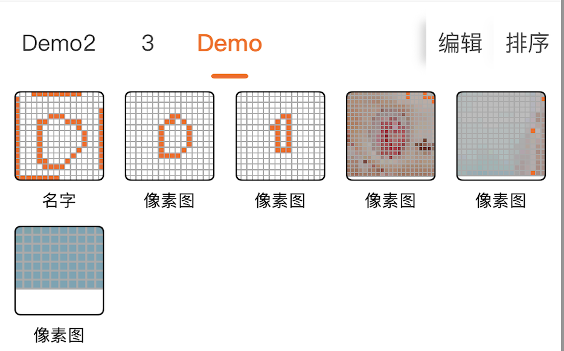
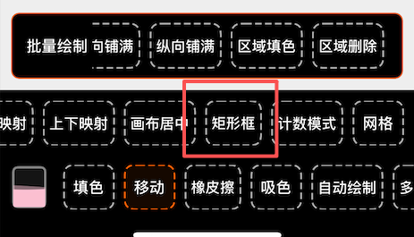
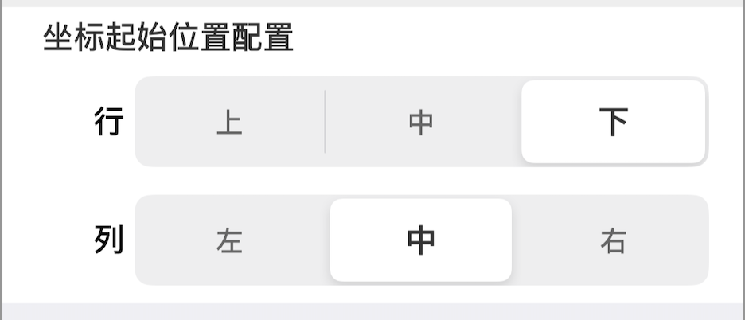
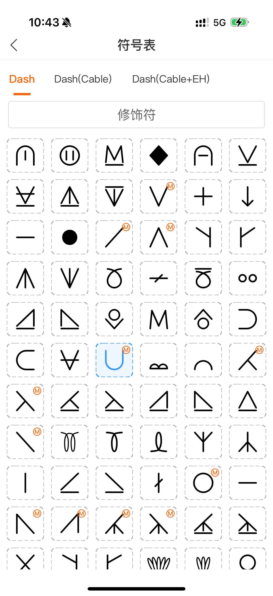
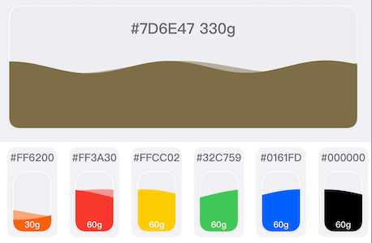

<!-- watch-settings-scenes-2026-11-12 -->
- 2026-11-12 · 開發中，尚未發佈 · 協作設定依編織計數器、棒針編輯器、編織筆記及鉤針編輯器分別配置。計數器、棒針編輯器、鉤針編輯器與編織筆記已接入，可各自設定雙指互點動作。 在編織筆記中，開啟計數器的「…」選單或長按計數器，選擇「與 Apple Watch 協作」。已綁定項目顯示手錶標記，也可從右上角手錶選單切換目標。手錶只操作選定計數器。手機翻頁、收起面板或切換其他 App 後，保持連線即可繼續計數。離開閱讀器會暫停，回到同一筆記後恢復。 手錶可以連續加減。可推算的數字會立即顯示，待同步次數會在下方提示。iPhone 依序儲存後確認。需要在手機確認的進位會暫停待處理操作，確認後繼續。切換目標或計數設定時，請核對先前未確認的操作。棒針圖解進入計數模式並開啟行標後，右上角「更多」左側會出現手錶按鈕，可手動開始或切換至目前圖解，每次移動一行。首次綁定會先儲存圖解；手錶顯示圖解名稱、行號及總行數，到達邊界時停止。退出計數模式、關閉行標或離開編輯器會暫停，已綁定時保留手錶入口；重新開啟同一圖解並進入計數模式可恢復。僅切換其他 App 看影片不解除綁定，保持連線即可繼續計數。完整儲存期間短暫暫停並自動恢復；修改行數或行號起點後需重新綁定。 鉤針圖解中，在指定計數器的「…」選單選擇「與 Apple Watch 協作」，只綁定該計數器；右上角手錶選單也可選擇目標，並勾選目前項目。已綁定計數器顯示小手錶標記，精簡模式亦保留。點擊其他計數器、改名、排序、翻頁或收起面板都不會改綁；切換影片 App 後保持連線即可繼續。加一超過上限會歸零，減一不低於零；清零保留綁定，刪除目標則結束協作且不自動轉移。離開編輯器或編輯計數器彈層時暫停，返回同一圖解後恢復。開始前先儲存，完整儲存期間短暫暫停，鉤針手勢偏好獨立設定。 「手錶回饋」中的「計數震動回饋」預設開啟，可自行關閉。此設定獨立於作品，控制手錶觸控加減與手勢計數成功後的震動，並在手錶連線後同步。
<!-- /watch-settings-scenes-2026-11-12 -->

<!-- workspace-recommendation-title-2026-11-11 -->
- 2026-11-11（開發中，未發布）：首頁頂部推薦卡片的標題下方加入黑色漸層，淺色封面上的白色文字更清晰。
<!-- /workspace-recommendation-title-2026-11-11 -->

<!-- pattern-draft-3d-maintenance-2026-11-11 -->
- 2026-11-11（開發中，未發布） · 正式版點按「預覽 → 3D試樣」時會顯示「3D預覽維護升級中，敬請期待」。
<!-- /pattern-draft-3d-maintenance-2026-11-11 -->

<!-- bernat-debug-2026-11-10 -->
2026-11-10 · Debug · 開發版內部樣板：重新建置 Debug App 後，在「新建版型→棒針→策略生成」清單底部開啟「Bernat M · 四主片工程对照」。固定 M 碼可編輯、儲存和重開；並非自動放碼策略，領邊及羅紋仍待完善，已接入合成參考人體的實驗試穿；最終品質與結果儲存仍在驗收中。

2026-11-11 · Debug · Bernat M 樣板計算完成後，點「試穿回饋」，切換胸圍、領口、袖口或下襬。虛線標出人體，實線標出衣物。胸圍可設定目標鬆量，袖口同時列出左右落點，下襬同時列出前後落點。範本腕點、未完成領邊與未通過品質檢查的模擬結果會標明參考範圍。 查看下襬時，短虛線標出人體參考腰線。點「查看人體」可暫時淡化衣物，點「恢復衣物」可回到正常顯示。拖曳結束後，指示線會依最終視角重新定位。
<!-- /bernat-debug-2026-11-10 -->

<!-- discover-detail-2026-11-09 -->
- 2026-11-09（開發中，未發布）：修復從首頁推薦或發現進入棒針詳情時，主執行緒反覆讀取完整圖庫造成的卡頓。副本狀態改為背景檢查；發現、收藏與讚好列表的卡片文字和空白處均可開啟詳情，封面預覽與收藏操作保持獨立。
- 發現四頻道的篩選預設收起，搜尋框右側可展開／收起，保留篩選數量、清除入口和列表位置；鉤針報價的完整圖庫副本檢查也改為背景執行，舊付費副本仍可直接開啟。
- 搜尋旁的展開／收起按鈕按內容縮窄並縮小箭頭，為搜尋框保留更多寬度。
<!-- /discover-detail-2026-11-09 -->

<!-- discover-recommendations-2026-11-08 -->
- 2026-11-08（開發中，尚未發佈）：首頁與探索推薦加入棒針、鉤針、版型內建內容，每日穩定輪替。首頁「快速開始」可直達探索對應頻道；探索頁記住所選分頁與各頻道篩選，先顯示本機內容，背景更新時保留頁面。點選內建推薦先進入詳情，再新增、開啟或使用。
- 修正探索列表底部遭裁切的問題，最後一筆內容可完整捲入安全區域；切換頻道及視窗尺寸變化時同步列表高度。
<!-- /discover-recommendations-2026-11-08 -->

<!-- crochet-instructions-2026-11-08 -->
- 2026-11-08（開發中）鉤針編輯器加入「編織說明」。可閱讀和編輯步驟、定位圖解，或點符號查看對應步驟。新加入的往返短針試樣、八環小星和三層花附有說明。
- 發現頁全部 19 款內建鉤針圖解附有分步說明。打開鉤針編輯器的書本圖示，即可逐步定位符號。已儲存且與內建原圖相符的副本，打開書本即可載入。
<!-- /crochet-instructions-2026-11-08 -->

<!-- discover-earth-2026-11-08 -->
- 2026-11-08（開發中）發現新增 6 元檔「雙色立體地球」，提供逐圈針數、藍綠換色和六併一閉合的完整可編輯圖解。
<!-- /discover-earth-2026-11-08 -->

<!-- discover-snowman-2026-11-08 -->
- 2026-11-08（開發中）發現新增 6 元檔「立體三段雪人」，包含逐圈編號、加減針、兩次五併一收口和雙色眼鼻，可新增為獨立圖解。
<!-- /discover-snowman-2026-11-08 -->

<!-- discover-stocking-2026-11-08 -->
- 2026-11-08（開發中）發現新增 6 元檔「爆米花針長襪」。完整圖解有工序編號、來源與可編輯副本，尺寸由線材、鉤針和密度試樣確定。
- 修正發現鉤針頻道同日發佈的排序。選擇「最新發佈」時，較晚加入的批次排在上方。
<!-- /discover-stocking-2026-11-08 -->

<!-- discover-paid-crochet-2026-11-08 -->
- 2026-11-08（開發中）：發現新增「花心祖母方片」與「立體嬰兒鞋」兩款完整複雜鉤針圖解，各為6元檔。提供工序編號、來源與可編輯副本。嬰兒鞋尺寸依線材、鉤針與密度試樣確定。
<!-- /discover-paid-crochet-2026-11-08 -->

<!-- discover-crochet-charts-2026-11-08 -->
<!-- discover-apple-luna-high-2026-11-08 -->
- 2026-11-08（開發中）：發現 → 鉤針新增「立體蘋果」完整圖解，983 枚有效針法，依複雜度進入 6 元檔。圖解含逐圈分段、共底加針提示、來源與可編輯副本；已通過獨立複核與簡中模擬器驗收。
- 補充：目前通過的是針序、圖解版面與 App 回讀驗收；整件形狀與來源 3D 模型的並排對照待補，尚不能確認成品外形。
<!-- /discover-apple-luna-high-2026-11-08 -->
- 2026-11-08（開發中）：「發現 → 鉤針」新增三層花、雙面五瓣花與狗牙邊葉片。三款各為 1 元檔，可查看來源與讀圖說明，解鎖後可加入鉤針編輯器。已儲存的副本可直接開啟。 內置圖解首次開啟會顯示全圖，重開時恢復已儲存的視口。
<!-- /discover-crochet-charts-2026-11-08 -->

<!-- discover-chart-commerce-2026-11-07 -->
- 2026-11-07（開發中，未對外發佈）：發現新增全部／免費／付費篩選、可查看來源的原生參考圖解及逐款解鎖；消耗型解鎖紀錄隨整庫備份保存，未完成交易可重試處理且不會再次發起付款。
- 新加入的副本按圈織補入下針。針法由 Line 補充，可以編輯。
- 這批參考圖解的發現封面、大圖預覽和新副本縮圖都顯示圈織下針。
- 進入「發現 → 鉤針」，可瀏覽首批 10 款內建圖解，包括試樣、紋理、邊飾和花片。開啟詳情可查看參考來源、預覽針法符號。加入後，可在鉤針編輯器中編輯本機副本。付費款沿用棒針圖解的消耗型 App 內購買級距，逐款解鎖。列表可依「全部／免費／付費」篩選。
- 首批10款棒針和10款鉤針圖解現全部免費。今後按一個完整花片或最小重複單元中的有效符號評估：不超過100個，或屬於基礎重複、簡單配色，均免費；101–300個且有中等複雜度，為¥1候選；301個以上且複雜度高、交付完整，為¥6候選。數量不會自動觸發收費，實際付費價格以商店為準。
<!-- /discover-chart-commerce-2026-11-07 -->

<!-- chart-json-readback-2026-11-06 -->
- 2026-11-06（開發中，未發布）：修復棒針圖解 JSON 重新讀取時粗網格線顏色的還原；已通過針對性原生模擬器測試，實機待驗。

<!-- discover-filter-selection-2026-11-06 -->
- 發現分類與主題標籤改用淺橙底、橙色文字及細邊框表示選取，統一明暗主題樣式。

<!-- discover-content-search-2026-11-06 -->
- 2026-11-06（開發中，未發佈）：發現頻道新增搜尋、分類/主題篩選及推薦/時間排序，快取或部分結果可重試。靜態與編譯檢查通過，真機待驗。

- 2026-11-06（開發中，未發佈）：修正棒針與鉤針編輯器頂部選單的安全區域配置，避免被瀏海或動態島遮擋。待實機驗證。

- 版型3D：改善人體肩臂與髖腿過渡，支援合格預覽隨作品儲存和還原，修正繼續模擬的階段提示。完整成衣試穿仍在改進中。

- 2026-10-27（開發中，未發布）：版型新增量測驅動的人台範本及真實3D參考材料試樣，支援閉合衣片擺放、臨時固定、重力垂落與基礎背心接縫；修改2D輪廓後可更新、同條件比較並匯出效果圖。人體原型與2D對照保留，舊偽3D入口轉為真實3D。已做模擬器驗證，仍待真機驗收；不提供精確合身或壓力結論。 修正複製人體原型衣片的閉合／鏡像邊界相容與直線採樣誤報自交；衣片無效時仍顯示目前人體並說明原因，修正後可重試。

- 2026-10-26（開發中，未發布）：版型工作台補任務選單、直線／圓／作圖點、統一物件層次與鎖定、前後身原型1:1對照、視窗恢復、圖紙樣式及記錄／檔案同源預覽。保留舊作；未編譯，待實機驗收。 新增橢圓、衣片邊緣拉伸／角落等比、比例鎖、精確尺寸與獨立排版旋轉；實際縮放更新估算，排版不改編織方向。 人體原型補唯讀元件選取框、位置鎖與解鎖拖動，選取參考自動退出畫筆，位置可復原及儲存。 連續繪製時收起自動物件選單，切回選取或節點編輯後恢復。 選取物件選單保留常用操作並可直達物件與圖層；列表更多支援編輯、重新命名、複製、層序和確認刪除，鎖定禁改，參考隱藏保源。刪除衣片保留人工標註與圖解記錄並提示關聯失效，可復原。 原型前身、後身、袖部及各人體參考可單獨移動、顯隱和排序。雙擊快捷編輯並可完成返回原工具，草繪和圖片支援整體變換。幾何完成與明確結束輪廓後在固定工具區顯示快捷選單，保留繪製工具；畫筆、橡皮與未完成路徑不彈出。

- 2026-10-26（開發中，未發佈）：一般短提示顯示期間仍可點擊按鈕、捲動列表及操作畫布；載入提示繼續依原有範圍阻擋互動。編織筆記保留頂部提示位置，並修正連續提示被提前清除的問題。未編譯，待實機驗證。

- 2026-10-23（開發中，未發佈）：版型全流程改為自由畫布，可從空白、策略、範本或人體原型起稿；補充關聯尺寸、Text/Tips、目前輪廓估算、按需預覽與輸出回流、設計圖匯出及舊作品保護。尚未編譯、尚待真機驗收；3D分離衣片展示不代表布料試穿。

- 2026-10-23: 已儲存的鉤針圖解會在離開編輯器或切到背景時記住畫布位置和縮放，重新開啟時優先還原；僅移動或縮放也會儲存。旋轉螢幕或改變視窗大小後，原來視口中心的畫布位置會回到目前視口中心。未編輯的新建空白圖僅瀏覽後關閉不會產生記錄。

- 2026-10-23: 已儲存的棒針圖解會在離開編輯器或切到背景時記住畫布位置和縮放，重新開啟時優先還原；僅移動或縮放也會儲存。旋轉螢幕或改變視窗大小後，會讓原來視口中心對應的圖解位置回到目前視口中心。未編輯的新建空白圖僅瀏覽後關閉不會產生記錄。

- 2026-10-22: 最佳化圖解較多作品的詳情載入：先顯示基本資訊，再更新資源摘要；作品技法改為點擊後分析，具體圖解按需載入。

### v2.1.3 （近期版本）

- 新增自动数据备份能力
- iPhone Duo 设备适配

钩针版块（按用户反馈体验升级）
- 多个长型针法开放曲率拉伸变形能力；
- 提供多选区域便捷操作，相似针法图的各项复制镜像能力；
- 其他钩针的用户体验优化；
- 图解 3D 模拟能力开发中，敬请期待

棒针版块
- 图解 3D 渲染能力持续升级中，数百中针法逐渐接入 3D 渲染能力
- 超大型图解的渲染算法升级

版型版块
- 当棒针的 3D 渲染能力达到目标之后，版型会开始支持 3D 人体试穿效果

### v2.0.3
- 新增發現模塊，精選圖解等你來織
- 其他體驗優化及問題修復

### v2.0.2
- 新增並優化版型設計相關功能，讓編織版型的創建與編輯更加便捷。
- 優化棒針圖解等功能的使用體驗。
- 修復已知問題並提升應用穩定性。

### v2.0.1
更新日誌
* 各版塊增加文件索引系統（支援各維度篩選及排序）；
* 首頁快速入口改版（一鍵直達核心目標頁面）；
* 全新設計的毛線庫存版塊（更加豐富的內容記錄及批量操作）；
* 棒針自定義符號支援使用圖片，並可選擇完整顯示或填滿裁切；
* 其他功能體驗優化（炫酷的照片翻轉查看效果）；

### v2.0.0(重磅更新)
* 作品版塊對接 Ravelry網，免費圖解快速獲取
* 全新的棒針 & 鉤針符號詳情，教學影片讓你少走彎路
* 棒針編輯器全新往返、圈織計數模式

### v1.9.9
根據用戶反饋優化
* iPad支援橫竪屏切換；
* 棒針編輯器體驗升級，提供更多便利區域操作；
* 其他UI及用戶交互體驗優化；

### v1.9.8

根據用戶反饋優化
* 修復圖解繪制時的卡頓問題；
* 計數器多任務編織計劃模塊升級；
* 計數器內部圖解模塊升級；
* 其他交互體驗優化；

### v1.9.7
鉤針編輯器
- 編輯器支援自動保存策略；
- 新增50+新鉤針符號；
- 其他UI細節及交互體驗優化。

棒針編輯器
-  超千行圍巾圖解繪制支援；
- 為超長圖解提供畫布定位支援；
- 支援自動保存策略，避免繪制進度意外丟失；

### v1.9.5~1.9.6
- 棒針工具支援超長圖解（千行）圍巾等繪制，並提供快捷定位導航；
- 棒針工具提供自動繪製圖解符號功能；
- 設定模塊升級，開始支援多項資料備份能力；

### v1.9.2~1.9.4
- 新增內置新手教學作品，快速瞭解作品、計數器、圖解與編織筆記。
- 支援完整作品包導入導出，包含毛線、圖解、PDF 與圖片資源。
- 升級棒針圖片輔助繪制及 PDF 圖解網格校准體驗。
- 優化棒針、鉤針、計數器和編織筆記，並新增五語言使用幫助。
- 修復多項導入、顯示與穩定性問題。

### v1.8.9 ~ 1.9.1
* 全新工作台模式重磅上線
* 鉤針版塊體驗升級

### v1.8.8 編織筆記版塊開始支援
* 修復iPad上iOS26.3+ 的tabbar不消失bug

新增編織筆記模塊
* 縮略圖支援快捷導航功能
* 內含多個計數器
* 多個可以轉向、可以縮放尺寸的標尺
* 元素管理版塊

### v1.8.7

* 全新頁面佈局： 我們調整了整體視覺與結構，將高頻使用的工具遷移至首頁，常用功能一觸即達；
* iOS 26 深度優化： 針對最新系統進行了全面的體驗適配，緊急修復了 iPad 客戶端在導出頁面時跳轉失效的已知問題；
* 細節體驗升級： 優化了多項底層性能與交互細節，讓日常使用更加絲滑順暢。

### v1.8.6
* 全新多語言棒針符號庫與針法詳解
* 像素編輯器新增區域剪切、選框資訊和統一導出
* 支援顏色與針法圖例、作者及版權資訊
* 編織計數器支援連續查看多頁 PDF
* 優化自定義鉤針符號、深色模式及操作穩定性

### v1.8.5
棒針工具
- 縮放和平移畫布時，選中的格子會牢牢固定，再也不會跟著畫面亂飄。
- 選區把手會自動吸附到單元格邊緣，且大小固定、觸控變紅，操作更精准。
- 移除了選區閃爍定時器，大幅降低了開著選區掛機時的手機發燙和耗電問題。
- 長針法符號在複製鋪滿時，如果末端空間不足會自動保留原樣，絕不會把符號切斷。
- 連續鋪滿操作現在支援一鍵撤銷，點一下就能恢復原狀，不用再狂點幾十次。
- 跨格的長符號現在點擊任意一格都能全選，並且支援一鍵整體替換，同時保持原有顏色。

鉤針工具
- 畫布支援以雙指中間為中心進行縮放，放大縮小更跟手，不再迷路。
- 移動符號時新增橫竪十字輔助線，幫你輕鬆完美對齊每個元素。
- 編輯框和把手大小固定不變，按住把手時會變成紅色，給你清晰的觸控反饋。
- 新增自動模式，點擊空白直接新建，點擊元素直接編輯，省去頻繁切換工具的麻煩。
- 支援長按或點擊底部按鈕多選，選中的符號可以一鍵打包成組。
- 成組後的符號支援整體移動、旋轉、縮放和複製，雙擊還能單獨修改組內單個成員。
- 圓形或矩形等排布新增正反方向、朝里、朝外、竪直等多種朝向調整，起點也能隨心換。

其他
- 提示文案全面同步簡體中文、英文、日語、韓語、法語，多國語言順暢切換。
- 完美兼容歷史作品，升級後舊圖紙可以正常打開和編輯，資料安全無影響。

### v1.8.3 & 1.8.4
- 鉤針符號樣式渲染優化。
- 優化自動繪制效果，新增單色及多種繪制風格與實時預覽。
- 重構畫布元素管理，支援按填充色、針法分類查看。
- 新增批量選擇、填充換色、符號換色及刪除操作。
- 優化撤銷、恢復及畫布控制工具的操作體驗。
- 改進圖片工具提示、彈層佈局與多語言支援。
- 修復圖片切換、透明度顯示及彈層滾動等問題。
- 優化多種尺寸像素畫布的繪制表現與操作穩定性。

### v1.8.2
- 編織計數器升級，當穩定編織模式與變化模式切換時，行針資料會保留同步；

### v1.7.5
- 為支援部分用戶的用眼健康，開始支援暗黑模式；

### v1.7.1 ~ 1.7.2
- 棒針圖解開始支援快捷模版，可在畫布中直接渲染
{: width="320"}

### v1.6.7 ~ 1.7.0
- 鉤針製圖工具上線
- 編輯器添加70+ 鉤針符號

> 這是首版，後續會根據實際體驗逐步迭代升級

### v1.6.2 ~ 1.6.5（如果你不喜歡開發者提供的資料項歸納格式？）

- 毛線版塊、編織作品版塊、圖解版塊統一開始支援文件自定義管理，用戶可以按照自己喜歡的方式歸納資料項；
- 為支援部分用戶高頻操作畫布的訴求，提供外置的統一樣式設定及提示語屏蔽選項；
- 圖解編輯器導出支援高清矢量圖方式，支援設定導出文件的標題及描述；

### v1.6.1
日常更新（用戶反饋優化）
- 棒針編輯器內開始支援畫布尺寸調整；
- 計數器新增第三種類型文本圖解，字體可調；

### v1.5.9 & v1.6.0

- 新增工具毛線編織小樣模擬器，一鍵獲取編織密度；
> 編織小樣依賴於特定毛線，因此它的入口位於毛線詳情頁；

### v1.5.7 & v1.5.8
編織作品及毛線記錄版塊升級；
- 作品（棒針、鉤針）作品在關聯所用毛線時，會自動計算消耗克重以及相關的價格
- 優化毛線詳情頁上下滑動時，已輸入數字被替換的問題；
- 毛線記錄版塊新增作品關聯消耗，自動添加已耗重量及價格的估算；
- 即將移除毛線首頁各種分類查看的限制；

### v1.5.6 計數器模塊升級
- 計數操作日誌新增備注功能，用於記錄錯誤或回溯；
- 日誌顏色加強[+][-]操作的區分度；

### 日常更新 v1.5.2 ~ 1.5.5，符號版塊大改版

編制符號手冊
- 按針法基本針法、加針、減針等版塊劃分所有符號
- 基本符號及修飾符支援中、英、日的三語對照詳情

### 日常更新 v1.5.0 & 1.5.1
- 編輯器多選控制區新增雜色處理功能，支援雜色閥值處理以及顏色集合快捷歸並等；
- 移除框選功能的限制權限，可完全使用相關功能；
- 編輯器支援跨作品區域複製，可以便捷的將不同作品打破重組；
- 添加一些共享作品，以及可共享的上傳通道；

### 日常更新 v1.4.5 & 1.4.6

- 編輯器支援框選批量複製、粘貼、橫縱鋪滿以及區域填色等操作，提花效率倍增；
{: width="300"}

- 增加了共享圖解版塊，持續添加可用的提花圖解，下一步更新費爾島提花；
- 自動繪制算法優化；

### v1.4.4

- 編輯器網格線行列支援自定義加粗間隔；

{: width="300"}

- 編輯器浮動坐標支援設定起始位置;

{: width="300"}

### v1.4.0~1.4.2重磅發佈支援500+編織符號
重磅升級，新增500+編織符號組合
- 新增基礎符號表(三大類Dash類型)；
- 新增自定義符號模塊，符號自定義；
- 圖解編輯器開始支援繪制符號庫；

{: width="300"}

### 1.3.8

日常更新
- 顏色選擇器支援從調色桶選色；
- 毛線及作品圖片資訊體驗優化，支援新增及單圖刪除功能；
- 本版多語言開始支援韓語；

### 1.3.7 計數器升級 & 聯動圖解編輯模塊

- UI體驗升級，收攏各類控制按鈕統一管理；
- 可以通過導入圖解作品，來啓動內部圖解樣式；
- 聯動圖解編輯模塊，提供真實的圖解計數；
- 提供類舊式列印機式的引導體驗及各類樣式配置；
- 可定制的行列計數模式，編織進度一目瞭然；
- 單獨的坐標控制鍵盤，加減一觸即可；
- 持久化的模式記憶，創作編織無縫切換；
- 快捷的輸入功能，可空降任意行列坐標；
- 編輯器顏色選擇支援記憶透明度；
- 優化多選模式操作體驗；

### v1.3.6

重磅更新
- 工具區升級為分欄模式，按模塊分類；
- 新增十字繡、提花及花色毛衣圖解製作工具，提供可選的懸浮坐標系統；
- 圖解項支援源文件級的分享，可無縫導入任意用戶的圖解源文件；
- 編輯器開始支援靈活的多選功能，各類批量處理用以提升創作效率；
- [多選模式]及[網格]模式加入工具區；
- 其他各類操作體驗優化；

### v1.3.5

日常更新
- 像素創作放開尺寸預設，現可自定義行列數了；
- 圖片編輯器優化，增加原圖尺寸比例；
- 修復iPad上pdf文件格式導出異常的bug；
- iPad上作品編輯器頁面修改為全屏展示；

### v1.3.3 ~ 1.3.4

> 1.3.4版本對畫布的自動繪制算法及網格相關的使用體驗進行了優化，當網格線隱藏時，自動繪制的結果可以比較好的還原底圖了。

- 像素作品列表重構，支援預覽圖與更新日期，加載效率足以支援多部複雜作品同時進行；
- 畫布放開了放縮的比例限制；
- 導出高清PDF文件功能優化，無論作品多複雜，均能放大至較大尺寸觀看；
- 畫布相關色值支援帶有透明度（RRGGBBAA）的16進制色值；
- 其他一系列工具操作體驗優化；

### v1.3.1（全新的像素化創作工具）~ v1.3.2

這是一個有趣的拼豆像素化創作工具；
- 支援各個維度的色彩定制，從單元格至畫布背景，色彩隨心意；
- 支援水平及垂直方向的同步繪制，映射總能創作令人意外的作品；
- 支援畫布隨意移位及放縮，並且導出時總以畫布最終位置為準；
- 支援底圖臨摹，圖片支援裁剪以及其他必要的操作；

### v1.2.6~1.3.0(新增工具調色桶)

- 調色桶支援混合不同比例的顏料及重量，萬色可調；
- 用心調制出來的色桶支援本地儲存；

{: width="300"}

### v1.2.5

- 毛線管理模塊新增餘量監測模塊，當毛線低於設定的閥值時，會在餘量告急表內展示，用戶可以選擇補充庫存或其他操作；

### v1.2.3~v1.2.4
- 體驗優化
- 新支援額外的語言種類

### v1.2.2
新版功能

- 作品模塊支援日曆查看；
- 作品發佈器新增日期及花費，可用於日曆展示；
- 日曆模塊內新增近期日期範圍快捷鍵；

### v1.2.1
新功能擴展

- 毛線庫存增加日曆篩選模塊，支援任意時間段
- 重構發佈器日期選擇模塊，新增日期選擇器；
- 計數器為聯動功能提供控制閥，可按需關閉；

### v1.2.0
計數器升級，圖解區與計數區開始聯動

- 當計數行變化時，圖解自動滾動至選中行；
- 圖解區左側支援行標記，選中會聯動圖解；
- 圖解與行標記滾動聯動；
- 增加聯動設定頁，用於聯動關係的設定；

### v1.1.9
功能擴展

- 新增工具區，便於後續各種輔助工具的添加；
- 本次新增智能顏色採集器，能夠採集目標區色值；
- 毛線發佈器也擴展了顏色採集器；

### v1.1.8
計數器模塊體驗優化

- 照片圖解採用矢量渲染方式以提高縮放清晰度；
- 當選項卡完整呈現時，計數區與控制區觸發更新；
- 優化圖解在tab切換時，展示區域被重新渲染的體驗；

### v1.1.7
- 新增永久會員選項；
- 分析模塊體驗優化；
- 同步功能體驗優化;

### v1.1.6

毛線模塊優化
- 新增顏色選擇器，輔助用戶選色；
- 最低系統版本降級至iOS14+；
- 庫存分析內容擴展；
- 其他一些體驗優化；

> 其他版本更新內容可在AppStore-App主頁查看。

<!-- bernat-debug-tryon-2026-11-10 -->
進入 3D 後，樣板使用合成參考人體。試穿計算結束後，可透過分享按鈕儲存工程預覽圖。品質檢查通過後才會儲存為可重開的試穿結果。
<!-- /bernat-debug-tryon-2026-11-10 -->
