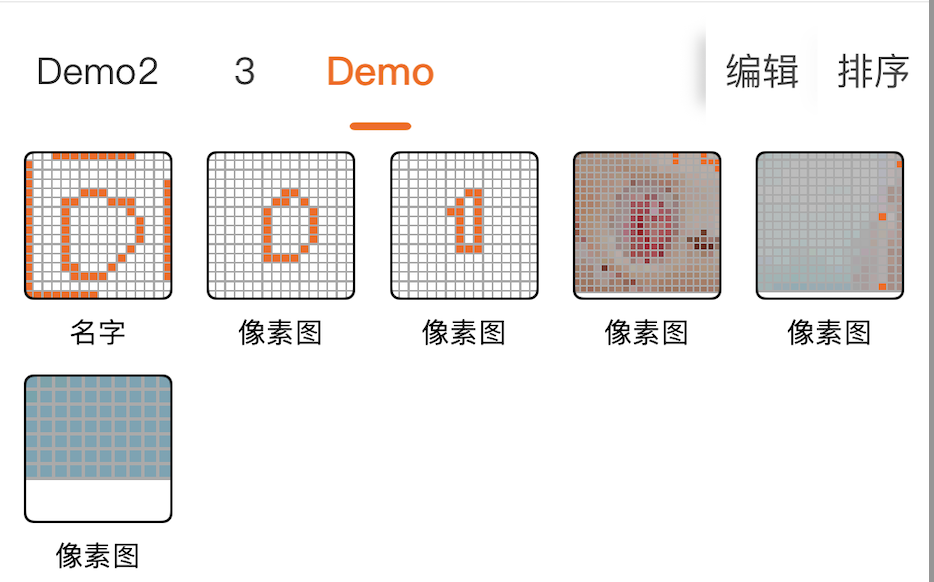
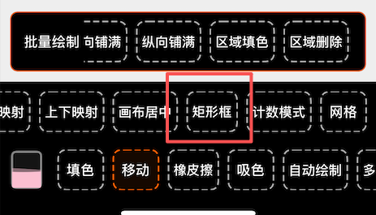
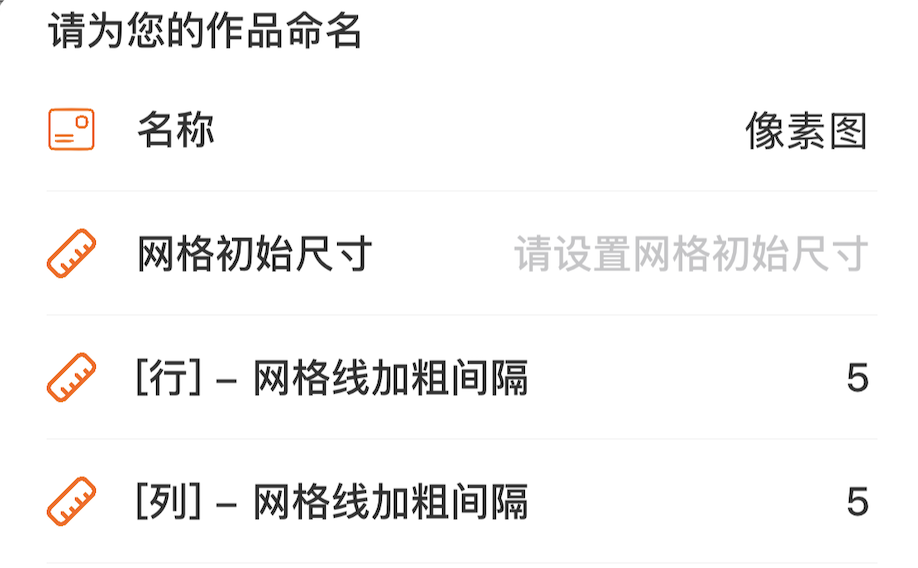
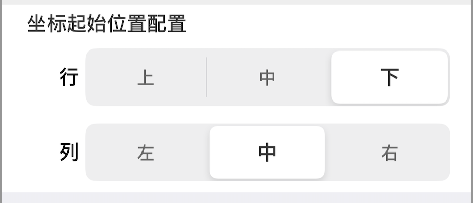
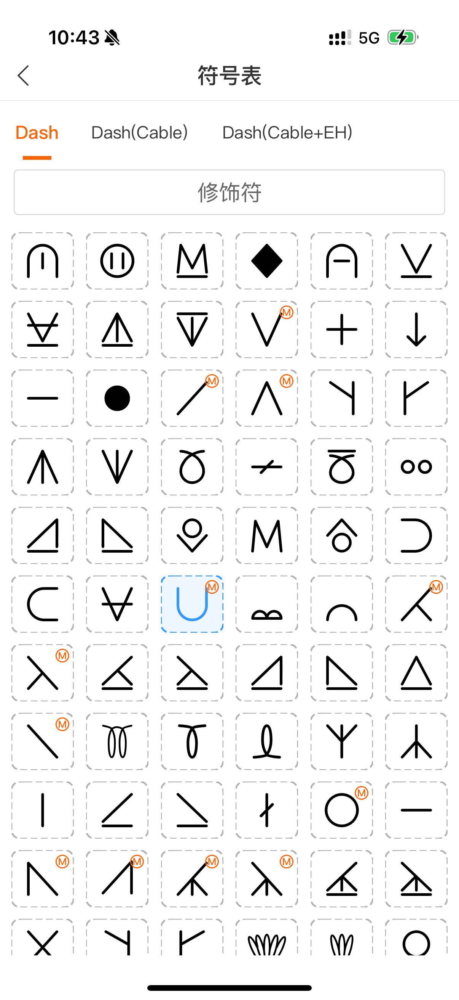
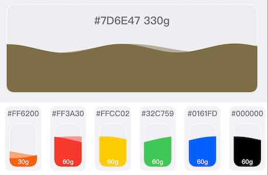

<!-- watch-settings-scenes-2026-11-12 -->
- 2026-11-12 · In development, unreleased · Collaboration settings are separate for counters, knitting charts, notes and crochet charts. Counters, knitting charts, crochet charts and knitting notes support independent double-tap actions. In Project Notes, open a counter’s More menu or touch and hold the counter, then choose Link with Apple Watch. A watch icon marks the linked counter. You can switch targets from the watch menu at the top right. Watch controls only the selected counter. Turning pages, hiding the panel or switching to another app keeps counting available while connected. Leaving the reader pauses collaboration. Return to the same note to resume. You can add or subtract repeatedly on Apple Watch. Predictable counts update immediately, and the pending count appears below. iPhone saves and confirms actions in order. Actions pause at a step that needs confirmation on iPhone and resume afterward. Check unconfirmed actions if you change targets or counting settings. In a knitting chart, enter counting mode and enable the row marker to show a watch button beside More at the top right. Manually start or switch the target to move one row at a time. The chart is saved before binding. Watch shows the chart name, row number and total rows, and stops at the range boundary. Leaving counting mode, disabling the row marker or leaving the editor pauses collaboration; the bound chart keeps its watch entry. Reopen the same chart in counting mode to resume. Switching to another app to watch a video keeps the target available while connected. Full saves briefly pause operations and resume automatically. Changing row count or row origin requires rebinding. In a crochet chart, choose Link with Apple Watch from one counter’s More menu to bind only that counter. The top-right watch menu also lists targets and checks the current one. A small watch mark remains visible on the linked counter, including compact mode. Tapping other counters, renaming, reordering, paging or hiding the panel never changes the target. Switching to a video app keeps counting available while connected. Incrementing past a positive maximum wraps to zero; subtraction stops at zero. Reset keeps the binding; deleting the target ends it without selecting another. Leaving the editor or editing a counter pauses collaboration; returning to the same chart resumes it. Binding saves first, full saves briefly pause operations, and crochet gestures have their own preference. Count haptic feedback under Watch feedback is on by default and can be turned off. This preference is independent of projects and controls vibrations after successful button or gesture counts. It syncs when the watch is connected.
<!-- /watch-settings-scenes-2026-11-12 -->

<!-- workspace-recommendation-title-2026-11-11 -->
- 2026-11-11 (in development, unreleased) — A dark gradient behind the titles on Home recommendation cards makes white text easier to read on light covers.
<!-- /workspace-recommendation-title-2026-11-11 -->

<!-- pattern-draft-3d-maintenance-2026-11-11 -->
- 2026-11-11 (in development, unreleased) · In the release build, tapping the pattern editor’s 3D sample opens a maintenance notice.
<!-- /pattern-draft-3d-maintenance-2026-11-11 -->

<!-- bernat-debug-2026-11-10 -->
2026-11-10 · Debug · Internal Debug sample: rebuild the app, then open Bernat M at the bottom of New Pattern → Knitting → Strategy Generation. This fixed-M four-panel reference supports editing, saving and reopening. The sample now uses a synthetic open-mesh body for experimental try-on. Automatic grading and neckband/rib details remain unfinished; final quality and result saving are under review.

2026-11-11 · Debug · When the Bernat M simulation finishes, tap **Fit review** and choose Chest, Neckline, Cuffs, or Hem. Dashed lines point to the body and solid lines point to the garment. Set a target range for chest ease, compare both cuffs, or compare the front and back hem. Template landmarks, unfinished neckband dimensions, and simulations that fail quality checks are identified in the panel. In Hem, a short dashed line marks the body’s reference waistline. Tap **View body** to fade the garment, then **Restore garment** to return to the normal view. The guide lines realign after you finish moving the view.
<!-- /bernat-debug-2026-11-10 -->

<!-- discover-detail-2026-11-09 -->
- 2026-11-09 (in development, unreleased): Fixed repeated full-library reads blocking the main thread when opening knitting chart details from Home or Discover. Saved-copy status is checked in the background. Card text and blank areas in Discover, Favorites and Likes open details; cover previews and favorites remain separate actions.
- Filters start collapsed in all four Discover channels, with Expand or Collapse beside search. Active counts, clear actions and list position are preserved. Crochet quotes also check full-library saved copies in the background; existing paid copies remain usable.
- The expand/collapse button now fits its content with a smaller arrow, leaving more width for search.
<!-- /discover-detail-2026-11-09 -->

<!-- discover-recommendations-2026-11-08 -->
- 2026-11-08 (in development, unreleased): Home and Discover feature built-in knitting charts, crochet charts and pattern strategies with stable daily rotation. Home Quick Start opens the matching Discover channel. Discover remembers your tab and per-channel filters, shows local content first and keeps it during background refresh. Built-in recommendations open details before you add, open or use the content.
- Fixed clipped content at the bottom of Discover lists so the last card can scroll fully into view; list heights follow channel and window-size changes.
<!-- /discover-recommendations-2026-11-08 -->

<!-- crochet-instructions-2026-11-08 -->
- 2026-11-08 (in development). The crochet editor now lets you read and edit instructions, locate the symbols for a step, and tap a symbol to find its step. Newly added copies of the single crochet swatch, eight-loop star and triple flower include instructions.
- All 19 built-in crochet charts in Discover now include step-by-step instructions. Open the book in the crochet editor to locate the symbols for each step. Saved copies that match the original load the instructions when you open the book.
<!-- /crochet-instructions-2026-11-08 -->

<!-- discover-earth-2026-11-08 -->
- 2026-11-08 (in development). Discover adds Two-Color 3D Earth at the CNY 6 unlock tier, with round counts, blue-green color changes and a six-stitch decrease closure in an editable chart.
<!-- /discover-earth-2026-11-08 -->

<!-- discover-snowman-2026-11-08 -->
- 2026-11-08 (in development). Discover adds the Three-part Crochet Snowman at the CNY 6 unlock tier, with numbered rounds, shaping, two sc5tog closures and colored eyes and nose.
<!-- /discover-snowman-2026-11-08 -->

<!-- discover-stocking-2026-11-08 -->
- 2026-11-08 (in development). Discover adds Popcorn Stocking at the CNY 6 unlock tier. The complete chart includes numbered stages, a source and an editable copy. Choose the size using your yarn, hook and gauge swatch.
- Fixed same-day sorting in the Discover crochet channel. When sorting by latest release, later batches now appear first.
<!-- /discover-stocking-2026-11-08 -->

<!-- discover-paid-crochet-2026-11-08 -->
- 2026-11-08 (in development): Discover adds two complete complex crochet charts, Flower Granny Square and Shaped Baby Bootie, each at the CNY 6 unlock tier. Both include numbered stages, sources and editable copies. Determine the bootie size with your yarn, hook and gauge swatch.
<!-- /discover-paid-crochet-2026-11-08 -->

<!-- discover-crochet-charts-2026-11-08 -->
<!-- discover-apple-luna-high-2026-11-08 -->
- 2026-11-08 (in development): Discover → Crochet adds Shaped Apple, a complete 983-stitch chart at the CNY 6 tier. It includes segmented rounds, shared-base increase guides, source details and an editable copy; independent review and simplified-Chinese simulator acceptance passed.
- Follow-up: Stitch sequence, chart layout and App readback passed; side-by-side comparison with the source 3D model is still pending, so the finished shape is not yet confirmed.
<!-- /discover-apple-luna-high-2026-11-08 -->
- 2026-11-08 (in development): Discover → Crochet adds a three-layer flower, a double-sided five-petal flower, and a picot-edged leaf. All three include source links and chart-reading notes. Each uses the CNY 1 unlock tier. Unlock a chart to add an editable copy. Previously saved copies still open directly. Built-in charts fit the canvas on first open and restore your saved view on reopening.
<!-- /discover-crochet-charts-2026-11-08 -->

<!-- discover-chart-commerce-2026-11-07 -->
- 2026-11-07 (in development, not publicly released): Discover adds All / Free / Paid filters, native reference charts with viewable sources, and per-chart unlocks. Consumable unlock records are included in full-library backups; unfinished transactions can be retried without starting a new payment.
- New copies are filled with knit stitches for working in the round. Line adds these stitches, and you can edit them.
- Discover covers, full-size previews, and new copy thumbnails show the knit stitches for these reference charts.
- Open Discover → Crochet to browse the first 10 built-in charts, including swatches, textured stitches, edgings, and motifs. Open a chart’s details to see its source and preview its stitch symbols. Add a chart to edit a local copy in the crochet editor. Paid charts unlock individually at the same consumable in-app purchase tiers as knitting charts. Use All, Free, or Paid to filter the list.
- The first 10 knitting and 10 crochet charts are now free. Future pricing considers meaningful stitch symbols in one complete motif or the smallest repeat. Up to 100 symbols, basic repeats and simple colorwork are free. Charts with 101–300 symbols and moderate complexity may qualify for the ¥1 (CNY) tier. Charts with 301 or more symbols, high complexity and a complete deliverable may qualify for ¥6 (CNY). Symbol count alone never makes a chart paid. The store determines the actual purchase price.
<!-- /discover-chart-commerce-2026-11-07 -->

<!-- chart-json-readback-2026-11-06 -->
- 2026-11-06 (in development, unreleased): Fixed restoration of bold grid-line colors when reading knitting chart JSON. Targeted native simulator tests passed; physical-device checks are pending.

<!-- discover-filter-selection-2026-11-06 -->
- Discover category and theme filters now use a light orange fill, orange text and a thin border for selection, with matching light and dark appearances.

<!-- discover-content-search-2026-11-06 -->
- 2026-11-06 (in development, unreleased): Discover channels gain search, category/theme filters and recommended/date sorting, with retry for cached or partial results. Static checks and compilation passed; device validation is pending.

- 2026-11-06 (in development, unreleased): Updated the knitting and crochet editors’ top toolbars to follow the current safe area and avoid the notch or Dynamic Island. Physical-device validation is pending.

- Pattern 3D: improved shoulder/arm and hip/leg transitions, saved and restored valid previews with projects, and fixed stage updates when resuming simulation. Full-garment try-on is still being improved.

- 2026-10-27 (in development, unreleased): Pattern Draft adds measurement-driven mannequin templates and real 3D samples with reference materials. Place and temporarily pin closed panels, drape them under gravity, and join a basic vest. Update after editing 2D contours, compare under matching conditions, and export an image. Body blocks and 2D comparisons remain; former pseudo-3D entries lead to real 3D. Simulator checks completed; physical-device acceptance is pending. No precise fit or pressure verdict is provided. Fixed closed-path and mirrored-boundary compatibility for copied body-block panels and false self-intersections from straight-edge sampling. Invalid panels now leave the current body visible with a reason and can be retried after correction.

- 2026-10-26 (in development, unreleased): Pattern Draft adds task menus, line/circle/construction tools, unified object ordering and locks, 1:1 front/back body-block comparison, window context, paper styles and shared record/file previews. Older documents remain supported. Not compiled; device validation pending. Also adds ellipses, piece stretch/proportional scale, aspect lock, precise dimensions and independent layout rotation. Resizing updates estimates; layout preserves knitting direction. Body references gain a read-only selection frame and position unlock/drag controls. Selecting a reference exits drawing; position changes support undo and saving. Automatic object menus stay hidden during drawing and return in selection or node editing. Selected-object menus offer frequent actions and direct access to Objects & Layers. Row menus add editing, rename, duplicate, stacking and confirmed deletion, respect locks and hide references without deleting their source. Piece deletion retains manual annotations and chart records with invalid-link warnings and supports Undo. Body-block front, back, sleeve and individual body references now move, hide and reorder independently. Double-tap opens quick editing with a return to the previous tool; sketches and images support whole-object transforms. Completed geometry and explicitly finished contours show actions in a fixed tool area while preserving the drawing tool. Brush, eraser and unfinished paths stay uninterrupted.

- 2026-10-26 (in development, unreleased): Buttons, lists and canvases remain interactive while ordinary brief messages are visible. Loading messages retain their existing interaction blocking. Project Notes keeps messages near the top and fixes newer messages being cleared too early. Not compiled; device validation pending.

- 2026-10-23 (in development, unreleased): Pattern Draft moves to a free canvas with blank, strategy, template and body-block starts, associated dimensions, Text/Tips, current-path estimates, optional previews, output preparation and return, design export and older-project protection. Not compiled or device-accepted. Separate flat pieces in 3D do not establish cloth fit.

- 2026-10-23: Saved crochet charts remember the canvas position and zoom when you leave the editor or put the app in the background, and restore that view when reopened. Panning or zooming alone is saved too. After rotating the screen or resizing the window, the previous canvas center returns to the center of the current view. Browsing and closing a new, unedited blank chart does not create a saved record.

- 2026-10-23: Saved knitting charts remember the canvas position and zoom when you leave the editor or put the app in the background, and restore that view when reopened. Panning or zooming alone is saved too. After a screen rotation or window resize, the chart point that was at the center of the previous view returns to the center of the current view. Browsing a new, unedited blank chart and closing it does not create a saved record.

- 2026-10-22: Optimized details for projects with many charts: basic information appears first, followed by resource summaries. Techniques are analyzed when opened, and individual charts load on demand.

### It is recommended to update the version in time to enjoy a better user experience.

### v2.1.3 (Recent Version)

- New automatic data backup function added.
- Compatibility with iPhone Duo devices improved.

Hoop needle section (upgraded based on user feedback)
- Multiple long-needle patterns now support curvature stretching;
- Easy operation in multi-selection areas, and ability to duplicate similar needle patterns;
- User experience improvements for other hoop needle patterns;
- 3D simulation capabilities are being developed – stay tuned.

Crochet section
- 3D rendering capabilities continue to improve; hundreds of needle patterns are gradually being integrated with 3D rendering;
- Upgraded rendering algorithms for large-scale patterns.

Pattern section
- Once 3D rendering capabilities for crochet patterns reach the desired level, patterns will start to support 3D human fitting effects.

### v2.0.2
- Added and improved pattern design features for easier creation and editing.
- Improved the experience of knitting charts and other features.
- Fixed known issues and improved overall stability.

### v2.0.1
Release Notes

* File indexing system added to each section;
* Homepage quick access redesigned;
* Newly designed yarn inventory section;
* Knitting custom symbols can now use images with Fit Entire Image or Fill and Crop display modes;
* Other feature and experience optimizations;

### v2.0.0 (Major Update)
* The works section is now integrated with the Ravelry website, allowing for quick and free access to illustrated patterns.
* Brand-new details on crochet and knitting stitch symbols, along with instructional videos to help you avoid making mistakes.
* The crochet editor has been updated with a new round-trip function and a loop counting mode.

### v1.9.9
Optimized Based on User Feedback
* iPad now supports switching between portrait and landscape modes;
* Upgraded Knitting Pattern Editor with convenient area selection and editing tools;
* Other UI and user interaction experience optimizations;

### v1.9.8
User Feedback Optimizations

* Fixed lag issues during chart drawing;
* Upgraded the multi-task knitting project module in the Row Counter;
* Upgraded the built-in chart module in the Row Counter;
* Other interaction experience optimizations;

### v1.9.7
Crochet Pattern Editor

* Supports auto-save to prevent data loss;
* Added 50+ new crochet symbols;
* Other UI details and interaction experience optimizations.

Knitting Pattern Editor

* Supports rendering large scarf charts with over 1,000 rows;
* Canvas positioning support for extra-long pattern charts;
* Supports auto-save to prevent accidental loss of drafting progress;

### v1.9.5~1.9.6
- The crochet tool now supports the creation of very long illustrated designs (thousands of lines), such as scarves, and provides quick positioning and navigation;
- The crochet tool includes an automatic symbol drawing function;
- The settings module has been upgraded to support multiple data backup options;

### v1.9.2~1.9.4
- Added a built-in tutorial project for learning projects, counters, charts, and Project Notes.
- Added complete project package import and export, including yarn, charts, PDFs, and images.
- Improved image-assisted knitting chart creation and PDF grid calibration.
- Enhanced knitting, crochet, counter, and Project Notes workflows with multilingual guides.
- Fixed multiple import, display, and stability issues.

### v1.8.9 ~ 1.9.1
* A brand-new desktop mode is now available!
* The experience in the “Threaded Discussions” section has been improved.

### v1.8.8 The woven notes section has started to support it
* Fixed the tabbar bug on iPad where the tabbar would not disappear

Added a woven note-taking module
* Thumbnails support quick navigation
* Includes multiple counters
* Multiple rulers that can be rotated and scaled in size
* Element management section

### v1.8.7
* Brand New Page Layout: We have adjusted the overall visuals and structure, moving high-frequency tools to the homepage so your favorite features are now just one tap away;
* Deep Optimization for iOS 26: Fully adapted for the latest system to ensure a seamless experience, urgently fixing an issue where page redirection fails when exporting on iPad;
* Subtle Experience Upgrades: Optimized multiple underlying performance and interaction details to make your daily use even smoother.

### v1.8.6
* Expanded multilingual knitting symbol library with stitch guides
* Added region cutting, selection details, and unified export
* Added color and stitch legends, author, and copyright options
* Added continuous viewing for multi-page PDFs
* Improved custom crochet symbols, dark mode, and stability

### v1.8.5
棒针工具
- The selected grid stays firmly in place when zooming and panning the canvas, no more drifting with the screen.
- The selection handles now automatically snap to the cell edges, featuring a fixed size and turning red when touched for more precise operation.
- Removed the selection flashing timer, significantly reducing phone heating and battery drain when leaving the selection active.
- When copying and flooding multi-stitch symbols, the system will automatically preserve the original content if the end space is insufficient, never cutting symbols short.
- Continuous flooding operations now support one-click undo, allowing you to revert to the original state with a single tap instead of clicking dozens of times.
- Multi-grid long symbols can now be fully selected by clicking any single cell, supporting one-click replacement while maintaining the original color.

钩针工具
- The canvas now zooms with the midpoint between your two fingers as the center, making zooming and panning much more responsive without getting lost.
- A new horizontal and vertical crosshair guide appears when moving symbols to help you perfectly align every element with ease.
- The bounding box and handles remain at a fixed size, turning red when held to provide clear touch feedback.
- Added an automatic mode where clicking a blank space creates a new item and clicking an element enters editing directly, eliminating the hassle of constantly switching tools.
- Supports long-pressing or clicking the bottom button for multi-selection, allowing selected symbols to be grouped with one click.
- Grouped symbols can be moved, rotated, scaled, and copied as a whole, and double-clicking allows you to edit individual members within the group.
- Layout settings for circles or rectangles now feature new adjustments for direction (forward/reverse), orientation (inward/outward/vertical), and start point customization.

其他
- Prompt texts are fully synchronized in Simplified Chinese, English, Japanese, Korean, and French for seamless multi-language switching.
- Perfectly compatible with historical projects; old charts can be opened and edited normally after upgrading with zero impact on data safety.

### v1.8.3 & 1.8.4
What's New
- Optimized automatic drawing effects, adding monochrome and multiple drawing styles with real-time preview.
- Refactored canvas element management, supporting categorization by fill color and stitch type.
- Added batch selection, fill color replacement, symbol color replacement, and deletion operations.
- Optimized the user experience for undo, redo, and canvas control tools.
- Improved image tooltips, pop-up layouts, and multi-language support.
- Fixed issues with image switching, transparency display, and pop-up scrolling.
- Optimized drawing performance and operational stability for various pixel canvas sizes.

### v1.7.5
- To support the eye health of some users, dark mode has been supported.

### v1.7.1 ~ 1.7.2
- The stick pin diagram starts supporting shortcut templates
{: width="320"}

### v1.6.7 ~ 1.7.0
- The crochet drawing tool is launched
- Editor adds 70+ crochet symbols

> This is the first version, and it will be gradually iterated and upgraded according to the actual experience

### v1.6.2 ~ 1.6.5 (If you don't like the data item summary format provided by the developer?) ）

- The yarn section, weaving work section, and illustration section have unified support for file customization management, and users can summarize data items in their favorite way;
- To support some users' demands for high-frequency canvas operation, provide external unified style settings and prompt blocking options;
- Illustration editor exports high-definition vector images, and supports setting the title and description of the exported file.

### v1.6.1
Daily updates (user feedback optimization)
- Canvas resizing is now supported in the Stick Editor;
- A third type of text illustration has been added to the counter, with adjustable fonts.

### v1.5.9 & v1.6.0

- Added tool yarn knitting sample simulator to obtain weave density with one click；
> Knitting sample depends on a specific yarn, so its entry is on the yarn details page;

### v1.5.7 & v1.5.8
 Upgrade of the Knitting Works and Yarn Record sections;
- When associating yarns used with works (knitting needles, crochet hooks), the consumed weight in grams and related price are automatically calculated.
- Optimized the issue where entered numbers are replaced when scrolling up and down on the yarn detail page;
- Added work-associated consumption to the yarn record section, automatically adding estimates of consumed weight and price;
- The restrictions on viewing various categories on the yarn homepage will be removed soon;

### v1.5.6 Counter Module Upgrade
- Added a note function to the counting operation log for recording errors or tracing back;
- Enhanced the color distinction of [+] and [-] operations in the log;

### Daily update v1.5.2 ~ 1.5.5, the symbol section has been revamped

Compile a symbol manual
- Divide all symbols according to stitches, basic stitches, stitches, stitches, subtractions, etc
- Basic symbols and modifiers support trilingual details in Chinese, English and Japanese

### Daily update v1.5.0 & 1.5.1
- Added noise processing function in the editor multi-selection control area, supporting noise threshold processing and quick merging of color collections.
- Remove the restricted permissions of the box selection function to fully use the relevant functions;
- The editor supports cross-work copying, which can easily break and reorganize different works.
- - Add some shared works, as well as shareable upload channels;

### Daily Updates v1.4.5 & 1.4.6

- The editor supports batch copying, pasting, horizontal and vertical spreading, and area filling operations such as box selection, which doubles the efficiency of jacquard.

{: width="300"}

- Added a shared illustration section, continuously adding available jacquard illustrations, and updating Fair Isle jacquard in the next step;
- Automatic drawing algorithm optimization;

### v1.4.4

- Editor gridline rows support custom bold intervals；

{: width="300"}

- Editor floating coordinates support setting the starting position;

{: width="300"}

### v1.4.0~1.4.2 Major Upgrade: Added 500+ Knitting Symbol Combinations
- New basic symbol table (3 major Dash types)  
- Added custom symbol module with symbol customization  
- Diagram editor now supports symbol library drawing

> Bug evasion. When the interaction of the symbol control area in the editor fails, click the [Symbol] button at the bottom to recover. It is expected to be repaired tomorrow.

{: width="300"}

### 1.3.8

Daily Update  
- Color picker now supports selecting colors from the palette.  
- Improved experience for yarn and project images: now supports adding and deleting individual images.  
- Korean language is now supported in this version.  

### 1.3.7 Counter Upgrade & Linkage Diagram Editing Module

- UI experience upgrade, converge various control buttons for unified management;
- Internal diagram styles can be started by importing illustrated works;
- Linked diagram editing module to provide real illustration counting;
- Provide a bootstrap experience similar to that of an old printer and various style configurations;
- Customizable row counting mode for at-a-glance weaving progress;
- Separate coordinate control keyboard, just add or subtract one touch;
- Persistent pattern memory for seamless switching of creative weaving;
- Quick input function, can parachute any column coordinates;
- Editor color selection supports memory transparency;
- Optimized the multi-select mode operation experience;

### v1.3.6

Blockbuster update
- The tool area has been upgraded to a column mode, categorized by module;
- Added cross-stitch, jacquard and decorated sweater illustration tools with optional floating coordinate system;
- Illustration items support source file-level sharing, which can seamlessly import any user's illustration source file.
- The editor began to support flexible multi-selection functions, and various batch processing to improve creative efficiency.
- [Multi-select mode] and [Grid] modes have been added to the toolbox.
- Other types of operation experience optimization;

### v1.3.5

Daily updates
- Pixel creation has released the size preset, and the number of rows can now be customized;
- Image editor optimization to increase the size ratio of the original image;
- Fixed the bug of abnormal export of pdf file format on iPad.
- The work editor page on iPad has been changed to full-screen display;

### v1.3.3 ~ 1.3.4
> Version 1.3.4 optimizes the automatic drawing algorithm of canvas and the experience of grid-related usage. When the grid lines are hidden, the automatic drawing results can restore the base map better.

- Reconstruction of the pixel work list, support preview images and update dates, and the loading efficiency is enough to support multiple complex works at the same time.
- The canvas has been relaxed to reduce the scale limit;
- Optimized the function of exporting high-definition PDF files, no matter how complex the work is, it can be enlarged to a larger size.
- Canvas correlation color values support hexadecimal color values with transparency (RRGGBBAA);
- A series of other tool operation experience optimizations;

### v1.3.1 ~ 1.3.2

This is a fun Pindou pixelated creation tool;
- Supports color customization in all dimensions, from cells to canvas backgrounds, with any color you want;
- Supports synchronized drawing in both horizontal and vertical directions, and mapping always creates surprising works.
- It supports the canvas to shift and shrink at will, and always exports based on the final position of the canvas.
- Supports base image copying, pictures support cropping and other necessary operations;

### v1.2.6~1.3.0 (Added Color Mixing Bucket Tool)

- The color mixing bucket supports blending pigments in different proportions and weights, enabling unlimited color creation;
- Carefully mixed color buckets can be saved to local storage;

{: width="300"}

### v1.2.5

- When the yarn is lower than the set threshold, it will be displayed in the balance emergency table, and the user can choose to replenish the inventory or perform other operations.

### v1.2.3~v1.2.4
- Experience optimization
- New support for additional languages

### v1.2.2
New features

- The work module supports calendar viewing;
- Add dates and costs to the work publisher, which can be used for calendar display;
- Added a shortcut for the recent date range in the calendar module;

### v1.2.1
New feature extensions

- Yarn inventory increase calendar filtering module, support any time period
- Refactored the Publisher Date Selection module and added a date picker;
- The counter provides a control valve for the linkage function and can be closed as needed;

### v1.2.0
The counter is upgraded, and the diagram area and the counting area are linked

- When the count row changes, the diagram automatically scrolls to the selected row;
- Row markers are supported on the left side of the diagram area, and selecting them will link the diagram;
- Diagram and line marker scrolling linkage;
- Added the linkage settings page for setting the linkage relationship;

### v1.1.9
Functional expansion

- Added a new tool area to facilitate the addition of various auxiliary tools in the future;
- This time, the intelligent color collector is added, which can collect the color value of the target area;
- The yarn publisher has also been extended with a color grabber;

### v1.1.8
The counter module experience is optimized

- Photo illustrations are rendered in vectors to improve zoom clarity;
- When the tab is fully rendered, the counting area and control area are updated to trigger an update;
- Optimized the experience of re-rendering the display area when switching between tabs;

### v1.1.7
- Analysis module experience optimization;
- Synchronous function experience optimization;
- Support longest Membership Option;

### v1.1.6

Yarn module optimization
- Added a color picker to assist users in color selection;
- Minimum system version downgraded to iOS14+;
- Inventory analysis content extension;
- Some other experience optimizations;

### v1.1.5
Yarn module upgrade
- Added inventory analysis to the warehousing module;
- Support for inventory charts in various dimensions;

> Other version updates can be viewed on the AppStore-App homepage.

<!-- bernat-debug-tryon-2026-11-10 -->
Open 3D to try the sample on a synthetic reference body. When simulation finishes, use Share to save an engineering preview image. Only results that pass quality checks can be saved and reopened as try-on results.
<!-- /bernat-debug-tryon-2026-11-10 -->
